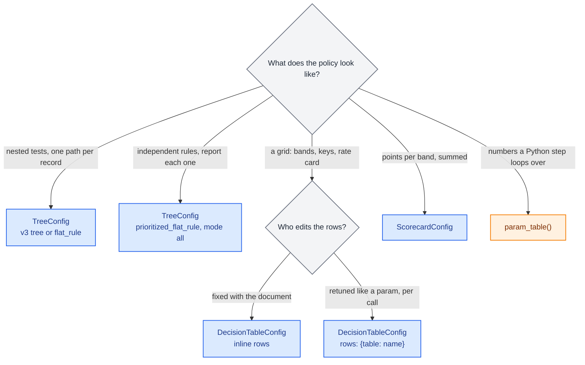
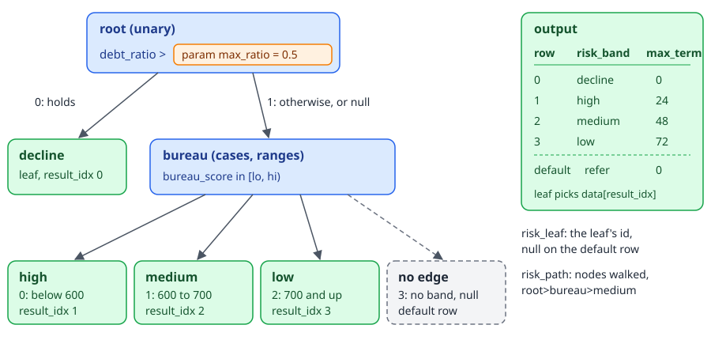
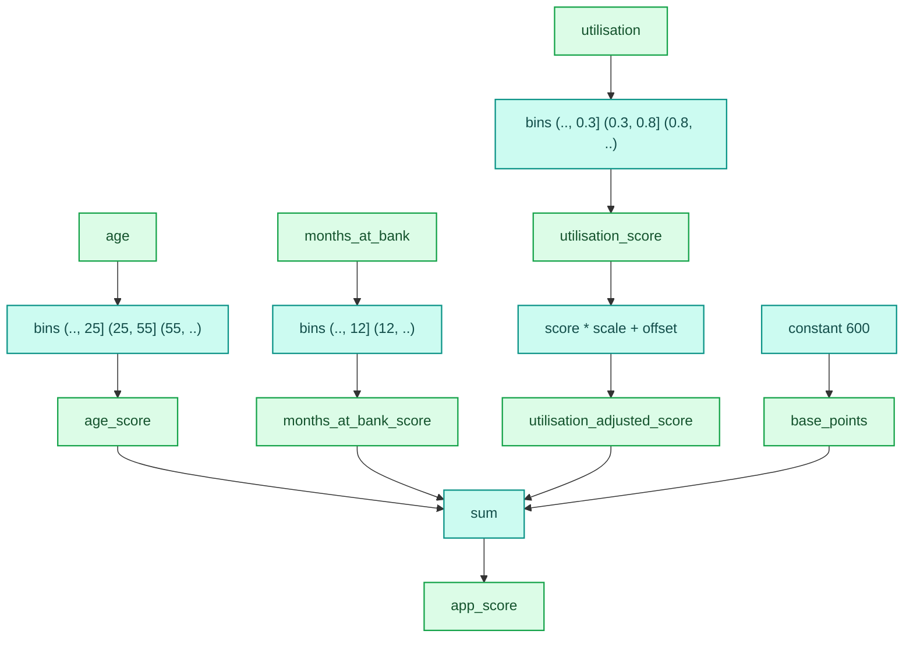

# Trees, tables and scorecards

Credit and fraud policy often comes as a document a business user owns: a decision tree drawn in an editor, a list of fraud rules, a rate card in a spreadsheet, a points scorecard signed off by a model team. decider runs each of these as a step. `TreeConfig`, `DecisionTableConfig` and `ScorecardConfig` load from JSON, sit in a `flow` beside your Python functions, compile into the same numba kernels, and expose their thresholds as params, so retuning one never rebuilds or recompiles the pipeline.

All three are `ConfigurableStep` subclasses. Each loads from a dict, a JSON string or a JSON file path, and its `type` tag picks the class:

| `type` | Class | Use it for |
|---|---|---|
| `"tree"` | `TreeConfig` | a decision tree (v3 node/edge document) or a set of flat rules |
| `"decision_table"` | `DecisionTableConfig` | a grid whose rows match records: bands, keys, rate cards |
| `"scorecard"` | `ScorecardConfig` | a points scorecard: binned variables summed into a score |

This guide covers using them. How they compile (the packed node arrays, the matcher's jump program, the bin kernels) is on the [configurable steps architecture page](../architecture/configurable-steps/index.md) and its pages on [trees](../architecture/configurable-steps/trees.md), [tables](../architecture/configurable-steps/tables.md) and [scorecards](../architecture/configurable-steps/scorecards.md).

## Choosing between them

A tree routes a record down one path of tests and reads its answer from the leaf it reaches. A table tries rows in order and takes the first one the record matches. A scorecard adds up points. Rows that a plain Python step should loop over are a [parameter table](parameter-tables.md), which is a different tool.



Some rules of thumb that come from the code:

- A tree reads string features as byte spans inside its kernel, so exact, prefix, suffix and substring string matches stay compiled. A regex, a case-insensitive match or a trimmed match runs the whole tree in Python.
- A decision table compares `String` columns and `List[String]` columns in its kernel as well. Its rows can come from the params document; a tree's structure cannot.
- A scorecard bins numbers in a kernel. A scorecard variable whose values bins hold strings runs in Python (the step reads a `str`).
- Hand-written tree walkers, rule loops and if-chain scorecards in Python are slower and are not editable by the people who own the policy. Use these steps instead.

## Decision trees

### A first tree

A v3 tree document lists `nodes` (what each node tests) and `edges` (which branch of a node leads where). This one declines a high debt ratio, then bands the rest by bureau score. It is saved as `risk_tree.json`:

```json
{
  "type": "tree", "name": "risk", "path_output": "risk_leaf", "trace_output": "risk_path",
  "tree": {
    "nodes": [
      {"id": "root", "data": {"type": "unary", "condition":
        {"op": ">", "feature": "debt_ratio", "threshold": {"param": "max_ratio", "default": 0.5}}}},
      {"id": "decline", "data": {"type": "leaf", "result_idx": 0}},
      {"id": "bureau", "data": {"type": "cases", "op": "ranges", "feature": "bureau_score",
        "conditions": [{"max": 600}, {"min": 600, "max": 700}, {"min": 700}]}},
      {"id": "high", "data": {"type": "leaf", "result_idx": 1}},
      {"id": "medium", "data": {"type": "leaf", "result_idx": 2}},
      {"id": "low", "data": {"type": "leaf", "result_idx": 3}}
    ],
    "edges": [
      {"source": "root", "target": "decline", "data": {"sourceIndex": 0}},
      {"source": "root", "target": "bureau", "data": {"sourceIndex": 1}},
      {"source": "bureau", "target": "high", "data": {"sourceIndex": 0}},
      {"source": "bureau", "target": "medium", "data": {"sourceIndex": 1}},
      {"source": "bureau", "target": "low", "data": {"sourceIndex": 2}}
    ],
    "output": {
      "data": [{"risk_band": "decline", "max_term": 0}, {"risk_band": "high", "max_term": 24},
               {"risk_band": "medium", "max_term": 48}, {"risk_band": "low", "max_term": 72}],
      "default": {"risk_band": "refer", "max_term": 0},
      "dtypes": [["risk_band", "String"], ["max_term", "Int64"]]
    }
  }
}
```

<div class="diagram" markdown>


*Each leaf selects one row of `output.data`; a branch with no edge selects the default row.*
</div>

```python
import polars as pl
from decider import TreeConfig

risk = TreeConfig.load("risk_tree.json")          # a path, JSON text or a dict
df = pl.DataFrame({"debt_ratio": [0.62, 0.30, 0.30, 0.20, 0.25],
                   "bureau_score": [710.0, 580.0, 650.0, 720.0, None]})
print(risk.run(df))
```

```text
shape: (5, 6)
┌────────────┬──────────────┬───────────┬──────────┬───────────┬────────────────────┐
│ debt_ratio ┆ bureau_score ┆ risk_band ┆ max_term ┆ risk_leaf ┆ risk_path          │
│ ---        ┆ ---          ┆ ---       ┆ ---      ┆ ---       ┆ ---                │
│ f64        ┆ f64          ┆ str       ┆ i64      ┆ str       ┆ str                │
╞════════════╪══════════════╪═══════════╪══════════╪═══════════╪════════════════════╡
│ 0.62       ┆ 710.0        ┆ decline   ┆ 0        ┆ decline   ┆ root>decline       │
│ 0.3        ┆ 580.0        ┆ high      ┆ 24       ┆ high      ┆ root>bureau>high   │
│ 0.3        ┆ 650.0        ┆ medium    ┆ 48       ┆ medium    ┆ root>bureau>medium │
│ 0.2        ┆ 720.0        ┆ low       ┆ 72       ┆ low       ┆ root>bureau>low    │
│ 0.25       ┆ null         ┆ refer     ┆ 0        ┆ null      ┆ root>bureau        │
└────────────┴──────────────┴───────────┴──────────┴───────────┴────────────────────┘
```

What each part of the document does:

- `name` is the step's name. It is the key of the tree's params in the params document and the prefix of its debugger locators (`risk#bureau`).
- The root is the node no edge points at. Each edge wires branch `sourceIndex` of `source` to `target` (`sourceIndex` may also be a list, for several branches into one node).
- A `unary` node has two branches: 0 when its condition holds, 1 otherwise. A `cases` node has one branch per condition plus a last one for "none of them".
- A leaf's `result_idx` picks a row of `output.data`. `-1`, or a branch with no edge, picks `output.default`. A column a row leaves out is null in that row.
- `output.dtypes` names each output column and its polars type, in order. These columns become the step's outputs.
- `path_output` adds a String column holding the id of the leaf that answered, null when the default row answered.
- `trace_output` adds a String column holding every node walked, joined with `>`, root first. The last row above shows a walk that ended at `bureau` because no band held.

Two things in that output matter for policy. The fifth applicant has no bureau score, so the `bureau` node took its last branch, which has no edge, and the tree answered with the default row (`refer`). And `cases` ranges are closed at the lower end by default (`end_logic: "lower_inclusive"`, so `[600, 700)`); set `"end_logic": "upper_inclusive"` for `(lo, hi]`.

### Thresholds as params

A threshold, bound, value or pattern written `{"param": "max_ratio", "default": 0.5}` is a param of the step. `parameters()` lists it, and the params document overrides it per call:

```python
import polars as pl
from decider import TreeConfig
from decider.lab.testing import no_recompile

risk = TreeConfig.load("risk_tree.json")
print(risk.parameters())
print(risk.parameters().defaults())

df = pl.DataFrame({"debt_ratio": [0.62, 0.30], "bureau_score": [710.0, 580.0]})
exe = risk.compile("fused")
print(exe.run(df)["risk_band"].to_list())
with no_recompile():                                  # raises if anything compiles
    print(exe.run(df, params={"risk": {"max_ratio": 0.7}})["risk_band"].to_list())
print(exe.score({"debt_ratio": 0.3, "bureau_score": 650.0}))
```

```text
{'risk': {'max_ratio': {'type': 'float', 'default': 0.5}}}
{'risk': {'max_ratio': 0.5}}
['decline', 'high']
['low', 'high']
{'debt_ratio': 0.3, 'bureau_score': 650.0, 'risk_band': 'medium', 'max_term': 48, 'risk_leaf': 'medium', 'risk_path': 'root>bureau>medium'}
```

The thresholds reach the kernel as arguments, never as literals in generated code, so the retuned run reuses the compiled kernel (`no_recompile` would raise otherwise). The note on table rows as runtime arrays records why: eight retunes written as literals meant eight full recompiles of 343 ms each at five rules, against zero compiles as arguments, for 1 to 4.5 ns more per row.

Params are per call, not per row. For a threshold that differs per record, compare a computed feature against a column, for example `{"op": ">", "feature": {"type": "computed", "expression": "ratio - customer_limit"}, "threshold": 0.0}`.

A param name becomes a Python field name, so it must be an identifier. A rule called `CF-0412` gets a param such as `cf_0412_amount`. Older documents that spell a reference `{"key": "name"}` load too, and a document's `parameters` block (`{"name": {"default_value": ...}}`) fills in the default of every reference to that name that has none.

### The same tree as flat rules

A flat-rule document nests each node's branches inside it instead of listing edges. `then` and `otherwise` hold a unary or composite node's branches; a `cases` node lists its `branches` and points into them by index. The result is the same `Tree`, run by the same kernel:

```python
import polars as pl
from decider import TreeConfig

risk = TreeConfig.load({
    "type": "tree", "name": "risk", "path_output": "risk_leaf",
    "tree": {
        "type": "flat_rule",
        "rule": {"rule": {
            "type": "unary", "id": "root",
            "condition": {"op": ">", "feature": "debt_ratio", "threshold": {"param": "max_ratio", "default": 0.5}},
            "then": {"type": "leaf", "id": "decline", "result_idx": 0},
            "otherwise": {
                "type": "cases", "op": "ranges", "id": "bureau", "feature": "bureau_score",
                "conditions": [{"when": {"max": 600}, "then": 0},
                               {"when": {"min": 600, "max": 700}, "then": 1},
                               {"when": {"min": 700}, "then": 2}],
                "otherwise": 3,
                "branches": [{"type": "leaf", "id": "high", "result_idx": 1},
                             {"type": "leaf", "id": "medium", "result_idx": 2},
                             {"type": "leaf", "id": "low", "result_idx": 3},
                             {"type": "leaf", "result_idx": -1}],
            },
        }},
        "output": {
            "data": [{"risk_band": "decline", "max_term": 0}, {"risk_band": "high", "max_term": 24},
                     {"risk_band": "medium", "max_term": 48}, {"risk_band": "low", "max_term": 72}],
            "default": {"risk_band": "refer", "max_term": 0},
            "dtypes": [["risk_band", "String"], ["max_term", "Int64"]],
        },
    },
})
df = pl.DataFrame({"debt_ratio": [0.62, 0.30, 0.30, 0.20, 0.25],
                   "bureau_score": [710.0, 580.0, 650.0, 720.0, None]})
print(risk.run(df))
print(sorted(risk.nodes))
```

```text
shape: (5, 5)
┌────────────┬──────────────┬───────────┬──────────┬───────────┐
│ debt_ratio ┆ bureau_score ┆ risk_band ┆ max_term ┆ risk_leaf │
│ ---        ┆ ---          ┆ ---       ┆ ---      ┆ ---       │
│ f64        ┆ f64          ┆ str       ┆ i64      ┆ str       │
╞════════════╪══════════════╪═══════════╪══════════╪═══════════╡
│ 0.62       ┆ 710.0        ┆ decline   ┆ 0        ┆ decline   │
│ 0.3        ┆ 580.0        ┆ high      ┆ 24       ┆ high      │
│ 0.3        ┆ 650.0        ┆ medium    ┆ 48       ┆ medium    │
│ 0.2        ┆ 720.0        ┆ low       ┆ 72       ┆ low       │
│ 0.25       ┆ null         ┆ refer     ┆ 0        ┆ null      │
└────────────┴──────────────┴───────────┴──────────┴───────────┘
['bureau', 'bureau.3', 'decline', 'high', 'low', 'medium', 'root']
```

A flat node without an `id` gets one from its position: the root is `"0"`, its `then` branch `"0.0"`, branch 3 of a cases node `"<id>.3"` (the unnamed default leaf above became `bureau.3`). The ids are stable across loads, so breakpoints and cache keys stay put. A v3 document converts with `TreeConfig.load(...).tree.to_flat_rules()`, which keeps node ids and repeats a node shared by two parents under each.

Tree documents of format v0, v1 and v2 are refused by name; save them again as v3 or flat rules. The tree editor's `"type": "ui-tree"` documents load as v3.

### Rule sets

A `prioritized_flat_rule` document holds several rules in priority order. With `"mode": "first_match"` (the default) the first rule that reaches a leaf other than the default answers. With `"mode": "all"` every rule answers, and each output column is repeated per rule as `<rule>.<column>`, named by the rule's `meta.name`. Fraud screening is the usual case for `all`:

```python
import polars as pl
from decider import TreeConfig


def rule(name, condition):
    return {"meta": {"name": name},
            "rule": {"type": "unary", "condition": condition,
                     "then": {"type": "leaf", "id": f"{name}_hit", "result_idx": 0}}}


rules = [
    rule("big_amount", {"op": ">", "feature": "amount",
                        "threshold": {"param": "big_amount", "default": 5000.0}}),
    rule("new_device", {"op": "<", "feature": "device_age_days", "threshold": 30}),
    rule("risky_merchant", {"op": "string_match", "feature": "merchant",
                            "patterns": ["Casino", "Crypto"], "match_type": "starts_with"}),
]
output = {"data": [{"hit": 1}], "default": {"hit": 0}, "dtypes": [["hit", "Int64"]]}
df = pl.DataFrame({"amount": [9000.0, 10.0, 120.0], "device_age_days": [3.0, 400.0, 90.0],
                   "merchant": ["Crypto World", "Grocer", None]})

every = TreeConfig.load({"type": "tree", "name": "fraud", "path_output": "leaf", "tree": {
    "type": "prioritized_flat_rule", "mode": "all", "rules": rules, "output": output}})
print(every.run(df).select("big_amount.hit", "new_device.hit", "risky_merchant.hit", "risky_merchant.leaf"))

first = TreeConfig.load({"type": "tree", "name": "fraud", "path_output": "leaf", "tree": {
    "type": "prioritized_flat_rule", "mode": "first_match", "rules": rules, "output": output}})
print(first.run(df).select("amount", "hit", "leaf"))
print(first.compile("fused").fallbacks())
```

```text
shape: (3, 4)
┌────────────────┬────────────────┬────────────────────┬─────────────────────┐
│ big_amount.hit ┆ new_device.hit ┆ risky_merchant.hit ┆ risky_merchant.leaf │
│ ---            ┆ ---            ┆ ---                ┆ ---                 │
│ i64            ┆ i64            ┆ i64                ┆ str                 │
╞════════════════╪════════════════╪════════════════════╪═════════════════════╡
│ 1              ┆ 1              ┆ 1                  ┆ risky_merchant_hit  │
│ 0              ┆ 0              ┆ 0                  ┆ null                │
│ 0              ┆ 0              ┆ 0                  ┆ null                │
└────────────────┴────────────────┴────────────────────┴─────────────────────┘
shape: (3, 3)
┌────────┬─────┬────────────────┐
│ amount ┆ hit ┆ leaf           │
│ ---    ┆ --- ┆ ---            │
│ f64    ┆ i64 ┆ str            │
╞════════╪═════╪════════════════╡
│ 9000.0 ┆ 1   ┆ big_amount_hit │
│ 10.0   ┆ 0   ┆ null           │
│ 120.0  ┆ 0   ┆ null           │
└────────┴─────┴────────────────┘
{}
```

`fallbacks()` is empty: the string match compiled with the rest of the tree. Change it to `"case_sensitive": false` and the whole tree runs in Python, with a `FallbackWarning` the first time it runs.

### Conditions

A `unary` node's `condition` (and each entry of a `composite`) is one of these, chosen by `op`:

| `op` | Holds when | Extra fields |
|---|---|---|
| `<`, `<=`, `==`, `>=`, `>`, `!=` | the feature compares true with `threshold` | `threshold` |
| `between` | `min <= x <= max`, closed at both ends; either bound may be left out | `min`, `max` |
| `isin` | the feature equals one of `values`; a single param reference means equality with that param | `values` |
| `string_match` | the string matches any of `patterns` | `patterns`, `match_type` (`exact`, `starts_with`, `ends_with`, `contains`, `regex`), `case_sensitive`, `trim_whitespace`, `null_handling` |
| `is_true`, `is_false` | the boolean feature is true or false | |

A `composite` node (`"type": "composite"`, `op` `and`, `or` or `not`) combines conditions; `not` takes exactly one. A `cases` node tests one feature against a list: `"op": "ranges"` with `{min, max}` bands (in `strict` mode, the default, literal bands must be sorted and touch), `"op": "isin"` with `{values}` sets, or `"op": "string_match"` with `{patterns}`.

A feature is a column name or a computed expression over columns:

```python
import polars as pl
from decider import TreeConfig

afford = TreeConfig.load({"type": "tree", "name": "afford", "tree": {
    "type": "flat_rule",
    "rule": {"rule": {
        "type": "composite", "op": "and", "conditions": [
            {"op": "isin", "feature": "employment", "values": [1, 2]},
            {"op": ">=", "feature": {"type": "computed", "expression": "income - expenses"},
             "threshold": {"param": "min_surplus", "default": 1500}},
        ],
        "then": {"type": "leaf", "id": "yes", "result_idx": 0},
        "otherwise": {"type": "leaf", "id": "no", "result_idx": 1}}},
    "output": {"data": [{"affordable": True}, {"affordable": False}],
               "dtypes": [["affordable", "Boolean"]]}}})
df = pl.DataFrame({"employment": [1.0, 3.0, 2.0, None], "income": [5000.0, 9000.0, 2000.0, 8000.0],
                   "expenses": [2000.0, 1000.0, 1000.0, 1000.0]})
print(afford.run(df))
```

```text
shape: (4, 4)
┌────────────┬────────┬──────────┬────────────┐
│ employment ┆ income ┆ expenses ┆ affordable │
│ ---        ┆ ---    ┆ ---      ┆ ---        │
│ f64        ┆ f64    ┆ f64      ┆ bool       │
╞════════════╪════════╪══════════╪════════════╡
│ 1.0        ┆ 5000.0 ┆ 2000.0   ┆ true       │
│ 3.0        ┆ 9000.0 ┆ 1000.0   ┆ false      │
│ 2.0        ┆ 2000.0 ┆ 1000.0   ┆ false      │
│ null       ┆ 8000.0 ┆ 1000.0   ┆ false      │
└────────────┴────────┴──────────┴────────────┘
```

The tree infers each feature's type from how it is used: a `string_match` feature is a `str`, a feature only tested with `is_true` or `is_false` is a `bool`, and anything else is a `float`. To compare an int64 column exactly (an id above `2**53`, say), declare it: `"feature_types": {"employment": "Int64"}`. Thresholds keep integers as integers for the same reason.

### Nulls in a tree

`null_handling` on the `TreeConfig` decides what a null numeric or boolean feature does. With `"otherwise"` (the default) a test on a null is unknown: NOT keeps it unknown, AND and OR follow three-valued logic, the node takes its otherwise branch, and a cases node takes its last branch. With `"error"` a null is a `MissingInputError`:

```python
import polars as pl
from decider import TreeConfig
from decider.exceptions import MissingInputError

doc = TreeConfig.load("risk_tree.json").model_dump(mode="json")
df = pl.DataFrame({"debt_ratio": [None, 0.25], "bureau_score": [710.0, None]})
print(TreeConfig.load(doc).run(df).select("debt_ratio", "bureau_score", "risk_band", "risk_path"))

strict = TreeConfig.load({**doc, "null_handling": "error"})
try:
    strict.run(df)
except MissingInputError as e:
    print(e)
```

```text
shape: (2, 4)
┌────────────┬──────────────┬───────────┬─────────────────┐
│ debt_ratio ┆ bureau_score ┆ risk_band ┆ risk_path       │
│ ---        ┆ ---          ┆ ---       ┆ ---             │
│ f64        ┆ f64          ┆ str       ┆ str             │
╞════════════╪══════════════╪═══════════╪═════════════════╡
│ null       ┆ 710.0        ┆ low       ┆ root>bureau>low │
│ 0.25       ┆ null         ┆ refer     ┆ root>bureau     │
└────────────┴──────────────┴───────────┴─────────────────┘
input 'bureau_score' of step 'risk' is required but column 'bureau_score' has 1 null row(s) of 2. Fix the data, or declare `bureau_score: T = missing_as(fill)` or `bureau_score: T | None`.
```

!!! warning "A null takes the otherwise branch"
    The first applicant has no debt ratio, so `debt_ratio > 0.5` is unknown and the root took its otherwise branch: the applicant was banded `low` instead of declined. Put the test whose failure is the safe answer on the `then` side, fill the input upstream with `missing_as`, or set `"null_handling": "error"`. The error's advice about `missing_as` applies to the function step that produces the column, since a tree document has no argument to annotate.

A string match has its own `null_handling` on the condition: `no_match` (the default, the match is false), `match`, or `error`. The `merchant` null in the fraud example scored no hit for that reason.

### Path columns of your own

`path_output` and `trace_output` cover most audit needs. For another route format, set `path_columns` to a function `fn(route, tree) -> dict` in Python (or with `path_columns: fn` on a flow file's `step:` node). It runs once per route when the step is built, never per row, and each key of the dict it returns becomes an output column. A `Route` has `visits` (a `Visit(node_id, node, branch, child)` per node passed) and `result_idx`. A document never holds the function, so it does not round-trip through JSON.

## Decision tables

A decision table declares its `columns`, holds `rows`, and says with an `expression` how a record matches a row. Each record takes the `outputs` of the first row it matches, or `default` when none does.

```python
import polars as pl
from decider import DecisionTableConfig

rate = DecisionTableConfig.load({
    "type": "decision_table", "name": "rate",
    "columns": {"grade": "String", "amt_lo": "Float64", "amt_hi": "Float64",
                "rate": "Float64", "tier": "String"},
    "rows": [
        {"grade": "A", "amt_lo": None,    "amt_hi": 50000.0, "rate": 0.115, "tier": "prime"},
        {"grade": "A", "amt_lo": 50000.0, "amt_hi": None,    "rate": 0.105, "tier": "prime"},
        {"grade": "B", "amt_lo": None,    "amt_hi": 50000.0, "rate": 0.165, "tier": "near"},
        {"grade": "B", "amt_lo": 50000.0, "amt_hi": None,    "rate": 0.155, "tier": "near"},
    ],
    "expression": {"type": "and", "expressions": [
        {"type": "eq", "variable": "grade", "value_column": "grade"},
        {"type": "between", "variable": "amount",
         "lower_bound_column": "amt_lo", "upper_bound_column": "amt_hi"}]},
    "outputs": ["rate", "tier"], "default": [None, "decline"],
})
df = pl.DataFrame({"grade": ["A", "A", "B", "C", None],
                   "amount": [20000.0, 50000.0, 80000.0, 10000.0, 10000.0]})
print(rate.run(df))
exe = rate.compile("fused")
print(exe.fallbacks())
print(exe.score({"grade": "B", "amount": 1000.0}))
```

```text
shape: (5, 4)
┌───────┬─────────┬───────┬─────────┐
│ grade ┆ amount  ┆ rate  ┆ tier    │
│ ---   ┆ ---     ┆ ---   ┆ ---     │
│ str   ┆ f64     ┆ f64   ┆ str     │
╞═══════╪═════════╪═══════╪═════════╡
│ A     ┆ 20000.0 ┆ 0.115 ┆ prime   │
│ A     ┆ 50000.0 ┆ 0.105 ┆ prime   │
│ B     ┆ 80000.0 ┆ 0.155 ┆ near    │
│ C     ┆ 10000.0 ┆ null  ┆ decline │
│ null  ┆ 10000.0 ┆ null  ┆ decline │
└───────┴─────────┴───────┴─────────┘
{}
{'grade': 'B', 'amount': 1000.0, 'rate': 0.165, 'tier': 'near'}
```

<div class="diagram" markdown>


*First matching row wins; rows sharing their `eq` values form one band ladder.*
</div>

### Expressions

| `type` | A row matches when | Fields |
|---|---|---|
| `eq` | the record's `variable` equals the row's `value_column` | `variable`, `value_column` |
| `between` | the variable lies in the row's band | `variable`, `lower_bound_column`, `upper_bound_column`, `mode`, `allow_gaps` |
| `in` | the variable is one of the row's list in `values_column` | `variable`, `values_column` |
| `is_true` | the boolean variable is true (it reads no column, so it holds for every row or none) | `variable` |
| `and`, `or` | every / some sub-expression holds | `expressions` |

`between` bands are `[lower, upper)` with `"mode": "lower_inclusive"` (the default) and `(lower, upper]` with `"upper_inclusive"`. Rows with the same `eq` values (above, the rows of one grade) form a ladder. Within a ladder the first row may leave its lower bound `None` and the last its upper, a missing bound in between is the neighbouring row's, and each upper must equal the next row's lower unless `"allow_gaps": true`. A ladder of one row must give at least one bound.

An `in` condition reads a `List` column:

```python
import polars as pl
from decider import DecisionTableConfig

fee = DecisionTableConfig.load({
    "type": "decision_table", "name": "channel_fee",
    "columns": {"channels": {"type": "List", "inner": "String"}, "fee": "Float64"},
    "rows": [{"channels": ["app", "web"], "fee": 0.0}, {"channels": ["branch"], "fee": 60.0}],
    "expression": {"type": "in", "variable": "channel", "values_column": "channels"},
    "outputs": ["fee"], "default": [69.0]})
print(fee.run(pl.DataFrame({"channel": ["web", "branch", "call", None]})))
```

```text
shape: (4, 2)
┌─────────┬──────┐
│ channel ┆ fee  │
│ ---     ┆ ---  │
│ str     ┆ f64  │
╞═════════╪══════╡
│ web     ┆ 0.0  │
│ branch  ┆ 60.0 │
│ call    ┆ 69.0 │
│ null    ┆ 69.0 │
└─────────┴──────┘
```

### Nulls and types in a table

A null input never matches a row, so a record with a null variable takes `default`. That holds for a null in a row too: an `eq` row with a null value is not a wildcard. A numeric variable is read as a float (a null becomes NaN, which no comparison matches); int columns are compared as float64.

An output is nullable when the default or some row's value is null. Without a `default`, a record that matches nothing gets nulls. Outputs are always single values; a `List` column can be matched on but not written.

### Rows from the params document

Inline rows are fixed in the table's document: changing them means a new document and a rebuild (never a recompile). Write `"rows": {"table": "card"}` instead and the rows become a required param of the step, held in the params document under the step's path and replaceable per call:

```python
import polars as pl
from decider import DecisionTableConfig, flow
from decider.exceptions import ParamsError
from decider.lab.testing import no_recompile

rate = DecisionTableConfig.load({
    "type": "decision_table", "name": "rate",
    "columns": {"grade": "String", "amt_lo": "Float64", "amt_hi": "Float64", "rate": "Float64",
                "tier": {"type": "Enum", "categories": ["prime", "near", "decline"]}},
    "rows": {"table": "card"},
    "expression": {"type": "and", "expressions": [
        {"type": "eq", "variable": "grade", "value_column": "grade"},
        {"type": "between", "variable": "amount",
         "lower_bound_column": "amt_lo", "upper_bound_column": "amt_hi"}]},
    "outputs": ["rate", "tier"], "default": [None, "decline"],
})
pricing = flow(rate, name="pricing")
print(pricing.parameters())
print(pricing.parameters().defaults())

card = [{"grade": "A", "amt_lo": None, "amt_hi": 50000.0, "rate": 0.115, "tier": "prime"},
        {"grade": "A", "amt_lo": 50000.0, "amt_hi": None, "rate": 0.105, "tier": "prime"}]
df = pl.DataFrame({"grade": ["A", "A", "B"], "amount": [20000.0, 80000.0, 10000.0]})
exe = pricing.compile("fused")
print(exe.run(df, params={"pricing": {"rate": {"card": card}}})["rate"].to_list())
with no_recompile():
    card2 = card + [{"grade": "B", "amt_lo": 0.0, "amt_hi": None, "rate": 0.17, "tier": "near"}]
    print(exe.run(df, params={"pricing": {"rate": {"card": card2}}})["rate"].to_list())

try:
    exe.run(df, params={"pricing": {"rate": {"card": [{**card[0], "tier": "gold"}]}}})
except ParamsError as e:
    print(e)
```

```text
{'pricing/rate': {'card': {'type': 'table', 'schema': {'grade': 'String', 'amt_lo': 'Float64', 'amt_hi': 'Float64', 'rate': 'Float64', 'tier': "Enum(categories=['prime', 'near', 'decline'])"}, 'required': True}}}
{'pricing': {'rate': {'card': []}}}
[0.115, 0.105, None]
[0.115, 0.105, 0.17]
invalid params (affects 3 rows):
pricing/rate: param 'card': Value error, rows don't fit the declared columns: row 0, column 'tier': 'gold' is not a Enum(categories=['prime', 'near', 'decline']); expected a list of rows like [{"grade": String, "amt_lo": Float64, "amt_hi": Float64, "rate": Float64, "tier": Enum(categories=['prime', 'near', 'decline'])}, ...] (got [{'grade': 'A', 'amt_lo': None, 'amt_hi': 50000.0, 'rate': 0.115, 'tier': 'gold'}])
```

The rows are checked against `columns` when the params document arrives, so a bad row fails before anything runs, naming the step, the param, the row and the column. A document without the rows is a `ParamsError` (`param 'card' is required but missing`). `defaults()` shows the table as `[]`: with no rows every record takes `default`.

A `String` output of a params table must be declared as an `Enum` with its categories. The kernel returns a string output as the index of its value, so the values must be known before the rows arrive. Without it, building the step fails with `output column 'tier' is a String and its rows come from params, so its values aren't known up front; declare it {"type": "Enum", "categories": [...]}`. Adding a category is a schema change and rebuilds the step.

`{"table": "card", "shared": true}` reads the rows from the document's top-level `shared.card` instead, so several tables can use one. The decision-tables note measured the cost of param rows: 12 bands through `run(df)` took 164 ns per row inline and 178 ns per row from params, on a development machine.

Tables written for decider 0.3, with columns and rows together in `"parameters": {"data": [...], "dtypes": {...}}`, load unchanged.

## Scorecards

A scorecard bins each variable into points and sums them into `output_name` (default `score`). Every variable's points are output too, as reason codes.

```python
import polars as pl
from decider import ScorecardConfig

pl.Config.set_tbl_cols(12)
card = ScorecardConfig.load({
    "type": "scorecard", "name": "application", "output_name": "app_score",
    "variables": [
        {"type": "constant", "score": 600, "output_name": "base_points"},
        {"type": "scored", "variable_name": "age", "default": {"value": 0},
         "bins": [{"value": -20, "upper_bound": {"param": "young", "default": 25}},
                  {"value": 10, "lower_bound": {"param": "young", "default": 25}, "upper_bound": 55},
                  {"value": 25, "lower_bound": 55}]},
        {"type": "scored", "variable_name": "months_at_bank", "default": {"value": -10},
         "bins": [{"value": 0, "upper_bound": 12}, {"value": 15, "lower_bound": 12}]},
        {"type": "adjusted", "scale": {"param": "util_scale", "default": 1.0}, "offset": 0.0,
         "variable": {"type": "scored", "variable_name": "utilisation", "default": {"value": 0},
                      "bins": [{"value": 40, "upper_bound": 0.3},
                               {"value": 0, "lower_bound": 0.3, "upper_bound": 0.8},
                               {"value": -60, "lower_bound": 0.8}]}},
    ],
})
df = pl.DataFrame({"age": [22.0, 25.0, 40.0, 70.0, None],
                   "months_at_bank": [3.0, 30.0, None, 120.0, 12.0],
                   "utilisation": [0.1, 0.5, 0.95, 0.3, None]})
print(card.run(df).drop("age", "months_at_bank", "utilisation"))
print(card.parameters())
```

```text
shape: (5, 6)
┌───────────┬─────────────┬───────────┬────────────────────┬───────────────────┬───────────────────┐
│ app_score ┆ base_points ┆ age_score ┆ months_at_bank_sco ┆ utilisation_score ┆ utilisation_adjus │
│ ---       ┆ ---         ┆ ---       ┆ re                 ┆ ---               ┆ ted_score         │
│ f64       ┆ f64         ┆ f64       ┆ ---                ┆ f64               ┆ ---               │
│           ┆             ┆           ┆ f64                ┆                   ┆ f64               │
╞═══════════╪═════════════╪═══════════╪════════════════════╪═══════════════════╪═══════════════════╡
│ 620.0     ┆ 600.0       ┆ -20.0     ┆ 0.0                ┆ 40.0              ┆ 40.0              │
│ 595.0     ┆ 600.0       ┆ -20.0     ┆ 15.0               ┆ 0.0               ┆ 0.0               │
│ 540.0     ┆ 600.0       ┆ 10.0      ┆ -10.0              ┆ -60.0             ┆ -60.0             │
│ 680.0     ┆ 600.0       ┆ 25.0      ┆ 15.0               ┆ 40.0              ┆ 40.0              │
│ 600.0     ┆ 600.0       ┆ 0.0       ┆ 0.0                ┆ 0.0               ┆ 0.0               │
└───────────┴─────────────┴───────────┴────────────────────┴───────────────────┴───────────────────┘
{'application/age': {'young': {'type': 'float', 'default': 25}}, 'application/utilisation_adjusted_score': {'util_scale': {'type': 'float', 'default': 1.0}}}
```



How the bins read:

- A bound bin scores `lower_bound < x <= upper_bound`. A missing bound is taken from the neighbouring bin, or is open at the ends. Age 25 scored -20 because 25 is the first bin's upper bound.
- A values bin (`"items": ["owner", "renter"]`) scores an input equal to one of its items and is checked before any bound bin.
- A null input, or a value no bin holds, scores the variable's `default`. Row 3's null `months_at_bank` scored -10 and row 5's null utilisation scored 0.
- With `strict` (the default) consecutive bound bins must meet exactly. With `"strict": false` gaps are allowed and score the default.
- An `adjusted` variable rescales a scored one as `score * scale + offset` and writes both; the sum uses the adjusted points.
- A `constant` adds the same points to every row.

Output names come from templates: `value_output_name` (default `"{variable_name}_score"`) on a scored variable and `variable_output_name` (default `"{variable_name}_adjusted_score"`) on an adjusted one.

Every bound and every points value can be a param. A scored variable's params live under `<scorecard>/<variable_name>`, as `parameters()` shows for `young`. An adjusted variable's `scale` and `offset` live under its output name (`application/utilisation_adjusted_score` above). Retuning a bin edge does not recompile:

```python
import polars as pl
from decider import ScorecardConfig
from decider.lab.testing import no_recompile

card = ScorecardConfig.load({
    "type": "scorecard", "name": "application", "output_name": "app_score",
    "variables": [
        {"type": "scored", "variable_name": "age", "default": {"value": 0},
         "bins": [{"value": -20, "upper_bound": {"param": "young", "default": 25}},
                  {"value": 10, "lower_bound": {"param": "young", "default": 25}}]},
        {"type": "scored", "variable_name": "residential_status", "default": {"value": -5},
         "bins": [{"value": 30, "items": ["owner"]}, {"value": 10, "items": ["renter", "with_parents"]}]},
    ],
})
df = pl.DataFrame({"age": [22.0, 40.0], "residential_status": ["owner", "lodger"]})
exe = card.compile("fused")
print(exe.run(df)["app_score"].to_list())
with no_recompile():
    print(exe.run(df, params={"application": {"age": {"young": 21.0}}})["app_score"].to_list())
print(exe.fallbacks())
```

```text
[10.0, 5.0]
[40.0, 5.0]
{'application/residential_status': "reads 'residential_status' as str, which no kernel holds"}
```

The `residential_status` variable has string items, so its step reads a `str` and runs in Python (the other variables stay compiled). The answers are the same in every mode; see [compile and fallback](compile-and-fallback.md) for what that costs.

## Writing and loading documents

`ConfigurableStep.load` (or `TreeConfig.load`, `DecisionTableConfig.load`, `ScorecardConfig.load`) takes a parsed dict, JSON text or a path to a `.json` file. Loading through the base class picks the class from `type`; loading through a subclass checks that `type`, if present, names that subclass. The three built-in tags resolve without importing their modules first.

YAML is not read by `load` directly. Parse it and pass the dict:

```python
import yaml
from decider import ConfigurableStep

text = """
type: decision_table
name: band
columns: {lo: Float64, hi: Float64, band: String}
rows:
  - {lo: null, hi: 600, band: C}
  - {lo: 600, hi: 700, band: B}
  - {lo: 700, hi: null, band: A}
expression: {type: between, variable: bureau_score, lower_bound_column: lo, upper_bound_column: hi}
outputs: [band]
default: [C]
"""
band = ConfigurableStep.load(yaml.safe_load(text))
print(type(band).__name__, band.compile("fused").score({"bureau_score": 655.0}))
```

```text
DecisionTableConfig {'bureau_score': 655.0, 'band': 'B'}
```

In a project, documents live in the config version next to the params document (`configs/0.1.0/risk.json`), and `build()` receives each one loaded, by argument name. [Projects and serving](projects-and-serving.md) shows the layout, and a [flow file](flow-files.md) can name a document as a `step:`.

### Editing a document

Configs are frozen: assigning a field raises. To change one, dump it, edit the dict and load it again. `model_dump(mode="json")` gives a document that loads back to an equal step; `exclude_defaults=True` drops the `type` tags and gives one that doesn't.

```python
import polars as pl
from decider import ConfigurableStep, TreeConfig

risk = TreeConfig.load("risk_tree.json")
doc = risk.model_dump(mode="json")
doc["tree"]["output"]["data"][3]["max_term"] = 84          # low risk now gets 84 months
edited = ConfigurableStep.load(doc)
print(edited == risk, edited.compile("fused").score({"debt_ratio": 0.2, "bureau_score": 720.0})["max_term"])
try:
    risk.name = "other"
except Exception as e:
    print(type(e).__name__, str(e).splitlines()[0])
```

```text
False 84
ValidationError 1 validation error for TreeConfig
```

Editing a literal in a document gives a new step whose IR is built again. It does not recompile when only values changed: tree thresholds and output rows, table rows and bin edges reach the kernel as data. A new output column, a new dtype or a change from a non-null to a nullable output does change the kernel's types and compiles once. For a change that business users make often, prefer a param (`{"param": ...}` or `{"table": ...}`) so it goes through the params document without touching the step document at all.

## Common errors

A misspelt `type` gets a suggestion:

```text
'decison_table' is not a registered ConfigurableStep type. Did you mean 'decision_table'? Import the module that defines it first, or name it by import path, '<module>:<Class>'.
```

Structural problems in a document are pydantic `ValidationError`s raised by `load`, before any data is seen. Some that come up:

| Message (abbreviated) | Cause and fix |
|---|---|
| `v2 tree documents are deprecated and no longer supported; save the tree again as a v3 tree or as flat rules` | an old tree format; re-save it from the editor |
| `Ranges are not continuous in strict mode. Range 0 ends at 10 but range 1 starts at 20.` | a gap between `cases` bands; close it or set `"strict": false` |
| `edge refers to unknown node 'zz'` | an edge's `target` is not a node id |
| `param name 'cf-0412' must be a Python identifier not starting with '_'; rename it, e.g. 'cf_0412'` | a param name with a hyphen or space |
| `Row 0 upper (50000.0) != row 1 lower (60000.0): ranges are not contiguous. Set allow_gaps=True to permit this.` | a gap in a table ladder |
| `BoundBin at index 1 lower_bound (12.0) must be equal to (in strict mode) previous upper_bound (10.0) ...` | scorecard bins that don't meet; fix the bins or set `"strict": false` |
| `Output column 'x' not found in parameters columns` | an `outputs` entry not in `columns` |
| `Default values length (1) must match outputs length (2)` | one `default` value per output |

## Where to go next

- [Parameter tables](parameter-tables.md): rows that a plain Python step loops over.
- [Flow files](flow-files.md): put a tree, table or scorecard document into a YAML pipeline by name.
- [Projects and serving](projects-and-serving.md): documents in a versioned config store, served over HTTP.
- [Debugging and testing](debugging-and-testing.md): break on a tree node (`risk#bureau`) or a table row (`rate#3`).
- [Diff and equivalence](diff-and-equivalence.md): prove two tree or table versions agree with z3.
