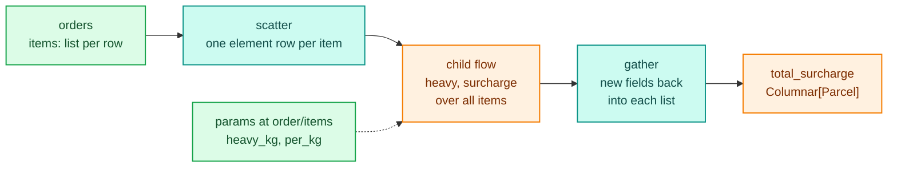
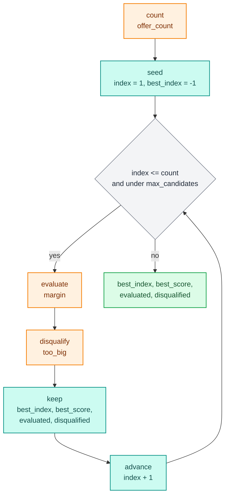

# Types, text, money and nested data

A step's annotations decide how each value is stored and whether a compiled kernel can hold it. Plain `float`, `int` and `bool` always compile. `decikit.ops` adds the types that let strings, money, list columns and struct columns compile too, plus metadata that tells tools what a number measures. This page covers each of them, then `each` and `optimise`, which work on lists of items.

```python
from decikit.ops import Columnar, Currency, Decimal, Duration, FieldMetadata, Percent, Struct, Text, decimal
```

| Value | Annotate it | Compiles | Notes |
|---|---|---|---|
| a number, a flag | `float`, `int`, `bool` | yes | int64 wraps silently in a kernel |
| a string you test (`==`, `startswith`, `in`) | `Text` | yes | read in place as UTF-8 bytes |
| a string you transform (`.upper()`, slicing, f-strings) | `str` | no | runs in Python, one `FallbackWarning` |
| money | `Currency`, `Currency["R"]` | yes | int64 count of 0.0001 units |
| a fixed-point number at another scale | `Decimal[p, s]` | yes | `p` at most 19 |
| a struct column, one record per row | `Struct[Item]` | yes | `Item` is a `TypedDict` |
| a list-of-structs column, heavy per-item work | `Columnar[Item]` | yes | one flat array per field |
| a date, a dict, a list of anything | `date`, `dict`, `list[dict]` | no | runs in Python, same answers |
| a rate or a term, for display | `Annotated[float, Percent()]`, `Annotated[int, Duration("months")]` | yes | the engine runs the plain type |

The plain type always works. A `str`, `date` or `list[dict]` step runs in every mode and gives the same answer; in a compiled mode it runs row by row in Python and says so once. [Compiled modes and fallback](compile-and-fallback.md) has the details. The examples below build on each other; run them top to bottom.

## Text: strings a kernel can test

Annotate a string input `Text` instead of `str` and the step stays in the kernel. `==`, `!=`, `len`, `in`, `startswith` and `endswith` compile and answer as they would on a `str`. The other side of a comparison may be a literal, a module-level constant or a `str` `param()`.

```python
import warnings

import polars as pl
from decikit import flow, param

warnings.simplefilter("ignore")

def government(employer: Text | None, prefix: str = param("GOV")) -> bool:
    return employer.startswith(prefix) or "DEPT" in employer

def short_name(employer: Text | None) -> bool:
    return len(employer) <= 4

def is_acme(employer: Text | None) -> bool:
    return employer == "acme"

def label(employer: str | None) -> str:
    return "" if employer is None else employer.title()

emp = flow(government, short_name, is_acme, label, name="emp").compile("fused")
print(emp.run(pl.DataFrame({"employer": ["GOV HEALTH", "acme", "TRANSPORT DEPT", None]})))
print(emp.fallbacks())
```

```text
shape: (4, 5)
┌────────────────┬────────────┬────────────┬─────────┬────────────────┐
│ employer       ┆ government ┆ short_name ┆ is_acme ┆ label          │
│ ---            ┆ ---        ┆ ---        ┆ ---     ┆ ---            │
│ str            ┆ bool       ┆ bool       ┆ bool    ┆ str            │
╞════════════════╪════════════╪════════════╪═════════╪════════════════╡
│ GOV HEALTH     ┆ true       ┆ false      ┆ false   ┆ Gov Health     │
│ acme           ┆ false      ┆ true       ┆ true    ┆ Acme           │
│ TRANSPORT DEPT ┆ true       ┆ false      ┆ false   ┆ Transport Dept │
│ null           ┆ false      ┆ true       ┆ false   ┆                │
└────────────────┴────────────┴────────────┴─────────┴────────────────┘
{'emp/label': "writes 'label' as str, which no kernel stores"}
```

`label` reads and writes a `str`, so it is the one step running in Python; the other three share a kernel. A null is not a string. It equals nothing (not even another null), has no prefix, suffix or part, and `len` reads it as 0. Declare the input `Text | None` to accept one; a plain `Text` input treats a null as missing and raises `MissingInputError`.

`Text` behaves the same in plain Python, which is what interpreted mode and your unit tests use:

```python
print(Text("private") == "private", Text(None) == Text(None), len(Text("héllo")))
```

```text
True False 5
```

Anything else a string can do needs a `str` input. Calling an unsupported method on a `Text` falls back to Python, and the reason is numba's:

```python
def shout(employer: Text) -> bool:
    return employer.upper() == "ACME"

print(flow(shout, name="u").compile("fused").fallbacks()["u/shout"].splitlines()[:3])
```

```text
['TypingError: Failed in nopython mode pipeline (step: nopython frontend)', "Unknown attribute 'upper' of type span", '']
```

One column can be read as `str` by one step and as `Text` by another. A step that returns `Text` writes a `str` column, in Python, exactly as a `str` output does. Trees and decision tables read their string columns as byte spans inside their own kernels, so string rules there do not fall back at all ([Trees, tables and scorecards](trees-tables-scorecards.md)).

## Money: Currency and Decimal

Floats cannot hold most decimal amounts exactly (`0.1 + 0.2` is `0.30000000000000004`). `Currency` and `Decimal` are fixed-point: an int64 count of `10**-scale` units, with the scale part of the type. `Currency` is a `Decimal` at scale 4. `Decimal[p, s]` sets another precision and scale, with `p` at most 19 because the count is an int64. `Currency["R"]` adds display units.

<div class="diagram" markdown>


*A precision up to 18 always fits; 19 digits is limited by int64.*
</div>

### Building values

```python
print([Currency(2.675), Currency("2.675"), Currency(2, 6500), Currency(-2, 5), -Currency(0, 5)])
print([Decimal("2.50"), Decimal(2.675, 2), Decimal("2.675", 2), Decimal(3), Currency(2, 6500, units="R")])
for build in (lambda: Decimal(2.65), lambda: Currency(2, -5)):
    try:
        build()
    except ValueError as e:
        print(e)
```

```text
[Currency('2.6750'), Currency('2.6750'), Currency('2.6500'), Currency('-2.0005'), Currency('-0.0005')]
[Decimal('2.50'), Decimal('2.67'), Decimal('2.68'), Decimal('3'), R 2.6500]
a float needs a scale: Decimal(2.65, scale=2)
minor must be from 0 to 9999 (units of 0.0001), not -5
```

- A float is rounded to the scale from its exact binary value: `Decimal(2.675, 2)` is 2.67, because the double is 2.67499999...
- A string is rounded from its digits: `Decimal("2.675", 2)` is 2.68. Pass strings when the digits matter.
- `Currency(major, minor)` is exact. `minor` counts 0.0001 units (0 to 9999), and the sign of `major` applies to the whole value, so -0.0005 is `-Currency(0, 5)`.
- A float needs an explicit scale; a string defaults to its own digits after the point, an int to 0.

### Arithmetic

```python
a, b = Decimal("2.50"), Decimal("0.05")
print([a * b, a + 1, Decimal("0.15") / 2, Currency(100) * 0.0175, a < 2.6, Decimal("0.30") == Decimal("0.3")])
print([float(Currency("1.5")), int(Decimal("-2.7"))])
for bad in (lambda: 1.5 / a, lambda: a + 1.5, lambda: a // 2, lambda: round(a, 1)):
    try:
        bad()
    except TypeError as e:
        print(e)
```

```text
[Decimal('0.12'), Decimal('3.50'), Decimal('0.08'), Decimal('1.7500'), True, True]
[1.5, -2]
float / Decimal is not defined: use float(d)
unsupported operand type(s) for +: 'Decimal' and 'float'
unsupported operand type(s) for //: 'Decimal' and 'int'
use decikit.ops.decimal.round(d, digits, mode) to round a Decimal
```

The rules, which hold in Python and inside a kernel alike:

- `+ - * /` between decimals give the larger of the two scales and round half-even once per operation, as polars does. `0.125` becomes `0.12` and `0.075` becomes `0.08`.
- An `int` counts as whole units: `a + 1`, `a * 3`.
- A float may multiply or divide a decimal, giving a decimal at the decimal's scale (`Currency(100) * 0.0175`). `float / d` and `d ± float` are errors; write `float(d)` for a ratio.
- `//`, `%`, `**` and the built-in `round(d, n)` are errors. Round with `decimal.round(d, digits, mode)`, which keeps the scale and zeroes the lower places.
- Comparisons are exact across scales and against ints. Against a float they compare `float(d)`.

```python
from decikit.ops.decimal import Rounding

print([decimal.round(Decimal("2.675"), 2), decimal.round(Decimal("2.665"), 2, Rounding.HALF_EVEN),
       decimal.round(Decimal("2.669"), 2, Rounding.DOWN)])
```

```text
[Decimal('2.680'), Decimal('2.660'), Decimal('2.660')]
```

### Money in a pipeline

A step reads and returns the decider toolkit's `Decimal` values in every mode. Inside a compiled step they stay int64, so a decimal costs about what an int does. A record may carry a `str`, `int`, `float`, the toolkit's `Decimal` or `decimal.Decimal` for a money input:

```python
from decimal import Decimal as StdDecimal
from typing import Annotated

def instalment(principal: Currency["R"], rate: Annotated[float, Percent()] = param(0.1275),
               months: Annotated[int, Duration("months")] = param(12)) -> Currency["R"]:
    return decimal.round(principal * (1 + rate) / months, 2, mode=Rounding.HALF_EVEN)

def fee(instalment: Currency["R"], floor: Currency = param(Currency(5, 5000))) -> Currency["R"]:
    return max(instalment, floor) + Currency(1, 2500)

loan = flow(instalment, fee, name="loan")
priced = loan.compile("fused")
print(priced.score({"principal": "1000.50"}))
print(priced.score({"principal": 10}, {"loan": {"fee": {"floor": "20"}}}))
print(loan.parameters().defaults())
print(priced.fallbacks())
```

```text
{'principal': '1000.50', 'fee': R 95.2600}
{'principal': 10, 'fee': R 21.2500}
{'loan': {'instalment': {'rate': 0.1275, 'months': 12}, 'fee': {'floor': '5.5000'}}}
{}
```

A `Currency` param appears in the params document as a string, so the document keeps its exact digits. Over a frame, a money input reads a polars `Decimal` column (rescaled half-even to the annotation's scale) or an integer column (whole units), and a money output is written as `Decimal(38, scale)`:

```python
frame = pl.DataFrame({"principal": [StdDecimal("1000.50"), StdDecimal("2.5")]}, schema={"principal": pl.Decimal(18, 2)})
print(priced.run(frame))
try:
    priced.run(pl.DataFrame({"principal": [1000.5]}))
except Exception as e:
    print(type(e).__name__, e)
```

```text
shape: (2, 2)
┌───────────────┬───────────────┐
│ principal     ┆ fee           │
│ ---           ┆ ---           │
│ decimal[18,2] ┆ decimal[38,4] │
╞═══════════════╪═══════════════╡
│ 1000.50       ┆ 95.2600       │
│ 2.50          ┆ 6.7500        │
└───────────────┴───────────────┘
ArrowKindError column 'principal' is Arrow double but is declared I64, which cannot read it.
```

A float column is refused for a money input, so a float can never become money by accident. Cast it in the frame (`pl.col("principal").cast(pl.Decimal(18, 2))`) if you have to. Two steps reading one column at different scales is a `WiringError`: `x/a reads input column 'amount' as Currency at scale 4, but x/b reads it as Decimal at scale 2; an input column has one type.`

Returning a decimal into an annotation of a coarser scale rounds half-even, and an `int` return counts as whole units:

```python
def as_cents(amount: Currency) -> Decimal[18, 2]:
    return amount

print(flow(as_cents, name="c").compile("fused").score({"amount": "1.2350"}))
```

```text
{'amount': '1.2350', 'as_cents': Decimal('1.24')}
```

### Overflow and running totals

A decimal or `int` result outside int64 raises `OverflowError` in Python and wraps silently in a compiled kernel. The two modes then disagree, so treat any product that can reach 9.2e18 as a bug:

```python
def grow(cents: Decimal[19, 0]) -> Decimal[19, 0]:
    return cents * 1_000_000_000_000

big = pl.DataFrame({"cents": [10_000_000]})
try:
    flow(grow, name="g").run(big)
except OverflowError as e:
    print(e)
print(flow(grow, name="g").compile("fused").run(big))
```

```text
10000000000000000000 does not fit a Decimal's int64; a compiled step wraps instead
shape: (1, 2)
┌──────────┬──────────────────────┐
│ cents    ┆ grow                 │
│ ---      ┆ ---                  │
│ i64      ┆ decimal[38,0]        │
╞══════════╪══════════════════════╡
│ 10000000 ┆ -8446744073709551616 │
└──────────┴──────────────────────┘
```

The `int64_overflow` check (code `DCD101`) flags products that can reach the limit before anything runs; see [Checks](checks.md).

Accumulators are where this bites in practice. A sum of squares of loan amounts in cents passes int64 after a handful of large loans. Accumulate running totals that can grow in `float64`, which is exact up to 2^53 and past that loses low digits instead of wrapping. Keep int64 or `Decimal` for amounts that must be exact:

```python
from typing import TypedDict

class Loan(TypedDict):
    cents: int

def spread_int(loans: Columnar[Loan]) -> int:
    total = 0
    for j in range(len(loans.cents)):
        total += loans.cents[j] * loans.cents[j]
    return total

def spread_float(loans: Columnar[Loan]) -> float:
    total = 0.0
    for j in range(len(loans.cents)):
        c = float(loans.cents[j])
        total += c * c
    return total

loans = pl.DataFrame({"loans": [[{"cents": 2_000_000_000}] * 3]})
print(flow(spread_int, spread_float, name="s").compile("fused").run(loans).select("spread_int", "spread_float"))
```

```text
shape: (1, 2)
┌──────────────────────┬──────────────┐
│ spread_int           ┆ spread_float │
│ ---                  ┆ ---          │
│ i64                  ┆ f64          │
╞══════════════════════╪══════════════╡
│ -6446744073709551616 ┆ 1.2000e19    │
└──────────────────────┴──────────────┘
```

The int accumulator wrapped to a negative number without any error; the float one holds 1.2e19.

## What a value measures

`Percent()`, `Duration(unit)` and your own `FieldMetadata` subclasses go inside `Annotated[...]`. The engine ignores them and runs the plain type; the flow debugger and other tools use them to show `0.25` as `25%` or `36` as `36 months`. Undeclared values are guessed from their names. `Currency["R"]` does the same for amounts.

```python
from dataclasses import dataclass

@dataclass(frozen=True)
class BureauScore(FieldMetadata):
    kind = "bureau_score"
    lo: int = 300
    hi: int = 850

def good_bureau(bureau: Annotated[float, BureauScore()]) -> bool:
    return bureau > 600

print(BureauScore().to_json(), Percent().to_json(), Duration("days").to_json())
print(flow(good_bureau, name="m").compile("fused").score({"bureau": 700.0}))
```

```text
{'kind': 'bureau_score', 'lo': 300, 'hi': 850} {'kind': 'percent'} {'kind': 'duration', 'unit': 'days'}
{'bureau': 700.0, 'good_bureau': True}
```

## Nested columns: Struct and Columnar

A struct column or a list-of-structs column reaches a kernel in one of two shapes. Both read the same as the plain type would, in every mode.

<div class="diagram" markdown>
![A list-of-structs column is read by Columnar[Item] as one flat array per field with a slice per row; a struct column is read by Struct[Item] as one record per row, by field name; a field that is itself nested is a TypeError](../assets/diagrams/guide-types-nested.svg)

*`Columnar` is struct-of-arrays: `for j in range(len(items.price))` walks the items, `for i in items` walks the fields.*
</div>

`Struct[Item]` reads a struct column as one record per row. `Item` is a `TypedDict`; the step reads `applicant["income"]` inside the kernel. A step can also return a `Struct[Item]` by returning a tuple of the fields in order.

```python
class Applicant(TypedDict):
    income: float
    age: int

def adult_income(applicant: Struct[Applicant]) -> float:
    return applicant["income"] if applicant["age"] >= 18 else 0.0

adults = flow(adult_income, name="s").compile("fused")
print(adults.run(pl.DataFrame({"applicant": [{"income": 1000.0, "age": 30}, {"income": 500.0, "age": 16}]})))
print(adults.fallbacks(), adults.score({"applicant": {"income": 1000.0, "age": 30}}))
```

```text
shape: (2, 2)
┌─────────────┬──────────────┐
│ applicant   ┆ adult_income │
│ ---         ┆ ---          │
│ struct[2]   ┆ f64          │
╞═════════════╪══════════════╡
│ {1000.0,30} ┆ 1000.0       │
│ {500.0,16}  ┆ 0.0          │
└─────────────┴──────────────┘
{} {'applicant': {'income': 1000.0, 'age': 30}, 'adult_income': 1000.0}
```

`Columnar[Item]` reads a `list[dict]` column as one flat array per field, sliced to the row's items. Index each field by position. An `Item` field may be `float`, `int`, `bool`, `str`, `float | None` or `str | None`:

```python
class Item(TypedDict):
    price: float
    qty: int

def basket(items: Columnar[Item]) -> float:
    t = 0.0
    for j in range(len(items.price)):
        t += items.price[j] * items.qty[j]
    return t

baskets = flow(basket, name="p").compile("fused")
print(baskets.run(pl.DataFrame({"items": [[{"price": 2.0, "qty": 3}, {"price": 5.0, "qty": 1}], [],
                                          [{"price": 4.0, "qty": 2}]]}))["basket"].to_list())
print(baskets.fallbacks())
```

```text
[11.0, 0.0, 8.0]
{}
```

Building the arrays costs about 20 µs per `score()` call (the figure the `Columnar` docstring gives), so a short list with a one-line body can be faster left as a plain `list[dict]` step. Reach for `Columnar` when the per-item work is heavy or the lists are long.

A field that is itself a list or struct is nested data, which neither shape holds, and binding the step raises a `TypeError` naming the field:

```python
class Tagged(TypedDict):
    price: float
    tags: list

def tagged_total(items: Columnar[Tagged]) -> float:
    return 0.0

try:
    flow(tagged_total, name="n").compile("fused").run(pl.DataFrame({"items": [[{"price": 1.0, "tags": ["a"]}]]}))
except TypeError as e:
    print(e)
```

```text
n/tagged_total: input 'items' is Columnar[Item], but Item field 'tags' is <class 'list'>; a field that is itself a list or struct is nested data, which Columnar[Item] cannot hold. Annotate 'items' as list[dict] instead (it runs in Python; accept with @allow_fallback).
```

Read such a column as its plain type (`list[dict]` or `dict`) instead. It runs in Python, gives the same answers, and `@allow_fallback` marks it as intended.

## Per-item rules with each

`each(column, child, name=...)` runs a child flow on every item of a list column, adds the child's outputs to each item as new fields, and writes the enriched list back. The child is a flow of ordinary steps, so per-item rules get `missing_as` and `param` like any other. A later `Columnar[Item]` step reads the new fields in a kernel:

```python
from decikit import each, missing_as

def heavy(weight: float = missing_as(0.0), heavy_kg: float = param(20.0)) -> bool:
    return weight > heavy_kg

def surcharge(heavy: bool, weight: float = missing_as(0.0), per_kg: float = param(1.5)) -> float:
    return weight * per_kg if heavy else 0.0

class Parcel(TypedDict):
    weight: float
    surcharge: float

def total_surcharge(items: Columnar[Parcel]) -> float:
    t = 0.0
    for j in range(len(items.surcharge)):
        t += items.surcharge[j]
    return t

order = flow(each("items", flow(heavy, surcharge, name="item"), name="items"), total_surcharge, name="order")
shipped = order.compile("fused")
orders = pl.DataFrame({"order_id": [1, 2, 3], "items": [[{"weight": 5.0}, {"weight": 25.0}], [], None]})
print(shipped.run(orders))
print(shipped.score({"order_id": 1, "items": [{"weight": 5.0}, {"weight": 25.0}]}))
```

```text
shape: (3, 3)
┌──────────┬─────────────────────────────────┬─────────────────┐
│ order_id ┆ items                           ┆ total_surcharge │
│ ---      ┆ ---                             ┆ ---             │
│ i64      ┆ list[struct[3]]                 ┆ f64             │
╞══════════╪═════════════════════════════════╪═════════════════╡
│ 1        ┆ [{5.0,false,0.0}, {25.0,true,3… ┆ 37.5            │
│ 2        ┆ []                              ┆ 0.0             │
│ 3        ┆ []                              ┆ 0.0             │
└──────────┴─────────────────────────────────┴─────────────────┘
{'order_id': 1, 'items': [{'weight': 5.0, 'heavy': False, 'surcharge': 0.0}, {'weight': 25.0, 'heavy': True, 'surcharge': 37.5}], 'total_surcharge': 37.5}
```



The child's params move up to the `each` step's path (`order/items/heavy_kg`), so two child steps may not share a param name. A null list reads as a row with no items and comes back as an empty list. `output="enriched"` writes the enriched list to a new column and leaves the original untouched.

`each` takes `execution_mode=EachMode.PER_ROW` or `EachMode.BATCH`. Both values are accepted for compatibility and run the same scatter and gather, so the choice does not change the result or the speed. The unified scatter and gather measured 219 µs for one record with five items and a one-step child, against 382 µs for the old per-row mode and 4.2 ms for the old batch mode.

## Best of N with optimise

"Try every candidate, keep the best" (the best offer, term, bundle or price point) is `optimise(count, evaluate, ...)`. `count` is a step writing the number of candidates for the row. `evaluate` is a flow that reads `index` (1 to `count`) and writes a score. The candidate with the highest score wins; a tie keeps the earlier one, and you minimise by negating the score. `disqualify` is an optional bool step run after `evaluate` that rejects a candidate.

```python
from decikit import optimise, step

class Offer(TypedDict):
    amount: float
    rate: float

@step(output="count")
def offer_count(offers: Columnar[Offer]) -> int:
    return len(offers.amount)

@step(output="margin")
def margin(index: int, offers: Columnar[Offer], cost_of_funds: float = param(0.0625)) -> float:
    j = index - 1
    return offers.amount[j] * (offers.rate[j] - cost_of_funds)

@step(output="too_big")
def too_big(index: int, offers: Columnar[Offer], income: float, multiple: float = param(4.0)) -> bool:
    return offers.amount[index - 1] > income * multiple

best = optimise(offer_count, flow(margin, name="evaluate"), score="margin", disqualify=too_big,
                max_candidates=16, name="best")
pick = flow(best, name="pricing").compile("fused")
offers = pl.DataFrame({"income": [1000.0, 100.0, 500.0],
                       "offers": [[{"amount": 2000.0, "rate": 0.125}, {"amount": 5000.0, "rate": 0.25}],
                                  [{"amount": 2000.0, "rate": 0.25}],
                                  []]})
print(pick.run(offers).drop("offers"))
print(sorted(pick.runner.packed))
print(flow(best, name="pricing").parameters().defaults())
```

```text
shape: (3, 5)
┌────────┬────────────┬─────────────┬───────────┬──────────────┐
│ income ┆ best_index ┆ best_score  ┆ evaluated ┆ disqualified │
│ ---    ┆ ---        ┆ ---         ┆ ---       ┆ ---          │
│ f64    ┆ i64        ┆ f64         ┆ i64       ┆ i64          │
╞════════╪════════════╪═════════════╪═══════════╪══════════════╡
│ 1000.0 ┆ 1          ┆ 125.0       ┆ 1         ┆ 1            │
│ 100.0  ┆ -1         ┆ -1.0000e300 ┆ 0         ┆ 1            │
│ 500.0  ┆ -1         ┆ -1.0000e300 ┆ 0         ┆ 0            │
└────────┴────────────┴─────────────┴───────────┴──────────────┘
['pricing/best/search']
{'pricing': {'best': {'search': {'body': {'evaluate': {'margin': {'cost_of_funds': 0.0625}}, 'too_big': {'multiple': 4.0}}}}}}
```



`optimise` lowers to a plain `loop`, so it packs into one fused kernel (`pricing/best/search` above). The outputs:

- `best_index` is the winning candidate, or `-1` when none survived (the second row's only offer is too big; the third row has none).
- `best_score` is its score, or `-1e300` with no winner.
- `evaluated` and `disqualified` count the candidates scored and rejected.
- `max_candidates` bounds the loop. `count` may be smaller per row; a larger `count` stops at the bound.
- `evaluate` must write the name given in `score=`, or `optimise` raises `WiringError: optimise 'best': evaluate does not write 'score'; it writes ['margin']`.

To get the winning candidate's fields back, pass `record=Item` and have `evaluate` also write `record` as a `Struct[Item]`:

```python
@step(output="score")
def margin_score(index: int, offers: Columnar[Offer], cost_of_funds: float = param(0.0625)) -> float:
    j = index - 1
    return offers.amount[j] * (offers.rate[j] - cost_of_funds)

@step(output="record")
def as_record(index: int, offers: Columnar[Offer]) -> Struct[Offer]:
    j = index - 1
    return (offers.amount[j], offers.rate[j])

with_record = optimise(offer_count, flow(margin_score, as_record, name="evaluate"), max_candidates=16,
                       name="best", record=Offer)
print(flow(with_record, name="pricing").compile("fused").run(offers.select("offers"))
      .select("best_index", "best_score", "record"))
```

```text
shape: (3, 3)
┌────────────┬─────────────┬───────────────┐
│ best_index ┆ best_score  ┆ record        │
│ ---        ┆ ---         ┆ ---           │
│ i64        ┆ f64         ┆ struct[2]     │
╞════════════╪═════════════╪═══════════════╡
│ 2          ┆ 937.5       ┆ {5000.0,0.25} │
│ 1          ┆ 375.0       ┆ {2000.0,0.25} │
│ -1         ┆ -1.0000e300 ┆ null          │
└────────────┴─────────────┴───────────────┘
```

`record` is null when nothing won. One current limit: with `record=`, the score must be named `score` (a `score="margin"` rename fails with a `MissingInputError` for `score`).

## Where to go next

- [Compiled modes and fallback](compile-and-fallback.md): what compiles, what falls back and how to accept it.
- [Steps, params, run and score](steps-and-params.md): rounding floats and the params document.
- [Checks](checks.md): `int64_overflow` and the other numeric checks.
- [Branches, loops and frame steps](branches-loops-frames.md): the control flow `optimise` is built from.
- [Trees, tables and scorecards](trees-tables-scorecards.md): string rules inside kernels.
