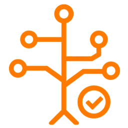

{ .hero-icon }

# Decider

Build decision pipelines from plain Python functions, run them over a polars frame or one record at a time, and serve them over HTTP.

- [Getting started](getting-started.md)

    Install decider, run a pipeline over a frame, score one record and retune a param.

- [Core concepts](concepts.md)

    Steps, params, the three run modes and the words the rest of the docs use.

- [User guides](guides/steps-and-params.md)

    Steps and params, branches and loops, money and nested types, trees, tables, scorecards, projects, serving, debugging, checks and experiments.

- [Tutorials](tutorials/quickstart.md)

    Worked projects: loan granting and pricing, and comparing two policy versions.

- [Architecture](architecture/index.md)

    The design from the high-level picture down to every component of the engine, the lab and the tooling.

- [API reference](reference.md)

    The public API, generated from the docstrings.

To contribute, see [CONTRIBUTING.md](https://github.com/capitec/dsp-decision-engine/blob/main/CONTRIBUTING.md).
