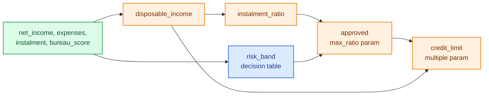

# Tutorial: compare two policy versions

A credit team wants to loosen its affordability rule and change how the credit limit is computed. Before the change ships, they need to know what changed in the code, which applicants get a different decision, whether a clean-up of the risk-band table changed anything at all, and how the new policy compares with the old one and with a third option across the whole book.

This tutorial does all of that on one small project, with every command run for real. You will:

1. build a lending pipeline, commit it and give its steps durable ids;
2. change a param and a step, then see the change with `diff.structure`, `diff.outputs` and `decikit diff`;
3. refactor a decision table and prove the refactor changes nothing, after catching a slip in a first attempt;
4. run an experiment of the new version against the old revision and a param scenario;
5. check the experiment's result against an independent diff.

<div class="diagram" markdown>


*The history you will build, and which tool compares which commits.*
</div>

You need the decider toolkit installed with the `prove` and `experiments` extras (`pip install 'decikit[prove,experiments]'`) and git. Run everything from the project directory.

## 1. The project

```text
lending-demo/
  lending/
    __init__.py
    pipeline.py
    configs/1.0.0/params.json
  datasets/
    applications.parquet
  make_data.py
  .gitignore           # __pycache__/, results/, *.pyc
```

The pipeline takes an application through disposable income, the instalment-to-income ratio, a bureau-score band from a decision table, the approval rule and the credit limit:

```python
# lending/pipeline.py
from decikit import DecisionTableConfig, flow, param, step
from decikit.ops import Text


@step
def disposable_income(net_income: float, expenses: float) -> float:
    return net_income - expenses


@step
def instalment_ratio(instalment: float, disposable_income: float) -> float:
    return instalment / disposable_income if disposable_income > 0 else 9.99


risk_band = DecisionTableConfig.load({
    "type": "decision_table", "name": "risk_band",
    "columns": {"lo": "Float64", "hi": "Float64", "band": "String"},
    "rows": [{"lo": None, "hi": 600.0, "band": "C"},
             {"lo": 600.0, "hi": 700.0, "band": "B"},
             {"lo": 700.0, "hi": None, "band": "A"}],
    "expression": {"type": "between", "variable": "bureau_score",
                   "lower_bound_column": "lo", "upper_bound_column": "hi"},
    "outputs": ["band"], "default": ["C"]})


@step
def approved(instalment_ratio: float, band: Text, max_ratio: float = param(0.35, ge=0.0, le=1.0)) -> bool:
    return band != "C" and instalment_ratio <= max_ratio


@step
def credit_limit(approved: bool, disposable_income: float, multiple: float = param(3.0, ge=0.0)) -> float:
    return disposable_income * multiple if approved else 0.0


def build():
    return flow(disposable_income, instalment_ratio, risk_band, approved, credit_limit,
                name="lending").emit("band", "approved")
```



`band` and `approved` are emitted so they stay in the output: the comparisons below need them. `band` is read as `Text`, so the comparison with `"C"` stays inside the compiled kernel ([Types and money](../guides/types-and-money.md)).

`configs/1.0.0/params.json` holds the defaults:

```json
{"lending": {"approved": {"max_ratio": 0.35}, "credit_limit": {"multiple": 3.0}}}
```

`make_data.py` writes 2,000 synthetic applications to `datasets/applications.parquet`, which makes them the project dataset `applications` ([Data and datasets](../guides/data-and-datasets.md)):

```python
# make_data.py
import random
import polars as pl

random.seed(7)
rows = []
for i in range(1, 2001):
    net = round(random.uniform(4000, 30000), 2)
    rows.append({
        "application_id": f"A-{i:05d}",
        "net_income": net,
        "expenses": round(net * random.uniform(0.3, 0.8), 2),
        "instalment": round(random.uniform(300, 6000), 2),
        "bureau_score": float(random.randint(450, 820)),
    })
pl.DataFrame(rows).write_parquet("datasets/applications.parquet")
```

The decider toolkit looks for `datasets/` beside the nearest `configs/` directory above the working directory, and in the working directory when there is none. Here the only `configs/` is inside the package, below the working directory, so `datasets/` resolves to `lending-demo/datasets`.

A first look at the current policy, over the dataset:

```python
import polars as pl
from decikit.lab import checks
from decikit.lab.data import dataset
from lending.pipeline import build

pipeline = build()
apps = dataset("applications").load()
print(apps.row_count, apps.suggested_key, apps.fingerprint[:12])
print(checks.run(pipeline).to_text())

out = pipeline.compile("fused").run(apps.frame)
print(out.group_by("band").agg(pl.len(), pl.col("approved").sum().alias("approved"),
                               pl.col("credit_limit").mean().round(2).alias("mean_limit")).sort("band"))
```

```text
2000 ('application_id',) 61c02883fd25
lending/pipeline.py:12: info DCD108 nan_propagation: lending/instalment_ratio: disposable_income is compared without a NaN guard; a NaN takes the false side silently
    fix: check math.isnan, or fill the null upstream
lending/pipeline.py:28: info DCD108 nan_propagation: lending/approved: instalment_ratio is compared without a NaN guard; a NaN takes the false side silently
    fix: check math.isnan, or fill the null upstream
lending: 2 info, 0 warning, 0 error
shape: (3, 4)
┌──────┬─────┬──────────┬────────────┐
│ band ┆ len ┆ approved ┆ mean_limit │
│ ---  ┆ --- ┆ ---      ┆ ---        │
│ str  ┆ u32 ┆ u32      ┆ f64        │
╞══════╪═════╪══════════╪════════════╡
│ A    ┆ 622 ┆ 260      ┆ 13175.99   │
│ B    ┆ 557 ┆ 238      ┆ 13495.31   │
│ C    ┆ 821 ┆ 0        ┆ 0.0        │
└──────┴─────┴──────────┴────────────┘
```

498 of 2,000 applicants are approved today. The two `info` findings are about NaN inputs, which this data does not have; [Checks](../guides/checks.md) explains them.

## 2. Commit and add durable ids

Commit the first version, then let `decikit ids` give every step a durable id. Ids let every later comparison match a step by identity instead of by name, so a rename never looks like a delete plus an add.

```text
$ git init -b main && git add -A && git commit -m "lending v1"
$ decikit ids lending
added 5 id(s) in 1 file(s)
  lending/pipeline.py:5  disposable_income  ->  id=61960951899c
  lending/pipeline.py:10  instalment_ratio  ->  id=f18ff80f85b3
  lending/pipeline.py:26  approved  ->  id=647f40f5714d
  lending/pipeline.py:31  credit_limit  ->  id=d05fad52d9f8
  lending/pipeline.py:37  lending  ->  id=f58544a1f4bb
```

`decikit ids` edits Python declarations only, so add the table's id to its document by hand. The whole change is:

```diff
-@step
+@step(id="61960951899c")
-@step
+@step(id="f18ff80f85b3")
-    "type": "decision_table", "name": "risk_band",
+    "type": "decision_table", "name": "risk_band", "id": "7ab1e5ab1e00",
-@step
+@step(id="647f40f5714d")
-@step
+@step(id="d05fad52d9f8")
-    return flow(disposable_income, instalment_ratio, risk_band, approved, credit_limit, name="lending").emit("band", "approved")
+    return flow(disposable_income, instalment_ratio, risk_band, approved, credit_limit, name="lending", id="f58544a1f4bb").emit("band", "approved")
```

```text
$ git commit -am "durable ids" && git tag v1
```

Your ids will be different; they are random.

## 3. Change a param and a step

The new policy has two parts. The approval ratio loosens from 0.35 to 0.40, and the credit limit is computed from what is left after the new instalment:

```diff
 @step(id="647f40f5714d")
-def approved(instalment_ratio: float, band: Text, max_ratio: float = param(0.35, ge=0.0, le=1.0)) -> bool:
+def approved(instalment_ratio: float, band: Text, max_ratio: float = param(0.40, ge=0.0, le=1.0)) -> bool:
     return band != "C" and instalment_ratio <= max_ratio


 @step(id="d05fad52d9f8")
-def credit_limit(approved: bool, disposable_income: float, multiple: float = param(3.0, ge=0.0)) -> float:
-    return disposable_income * multiple if approved else 0.0
+def credit_limit(approved: bool, disposable_income: float, instalment: float, multiple: float = param(3.0, ge=0.0)) -> float:
+    return (disposable_income - instalment) * multiple if approved else 0.0
```

### In a notebook, before committing

Keep the old pipeline object, edit the file, reload the module and compare. Nothing has to be committed yet:

```python
import importlib
import lending.pipeline
from decikit.lab import diff
from decikit.lab.data import dataset

old = lending.pipeline.build()
# ... edit lending/pipeline.py as above ...
importlib.reload(lending.pipeline)
new = lending.pipeline.build()

s = diff.structure(old, new)
print("identical:", s.identical)
for c in s.changed_steps:
    print("changed", c.ref.path, [k for k in ("code", "consts", "inputs", "outputs", "params") if getattr(c, k)])
for p in s.params:
    print("param", p.ref.path, p.name, p.field, p.old, "->", p.new)
```

```text
identical: False
changed lending/risk_band ['code', 'consts']
changed lending/approved ['params']
changed lending/credit_limit ['code', 'inputs']
param lending/approved max_ratio default 0.35 -> 0.4
```

`approved` changed only in its param declaration, and `credit_limit` in its code and inputs (it now reads `instalment`). `risk_band` is listed although its document did not change: the decider toolkit currently reports every tree and decision-table step as changed, because part of what it hashes for them differs on every build. Read that line as noise for now; step 4 compares the table properly.

Which applications does it affect?

```python
frame = dataset("applications").load().frame
o = diff.outputs(old, new, frame, key="application_id")
print(f"{o.rows_changed} of {o.rows_compared} rows changed")
for name, c in o.columns.items():
    print(name, "changed", c.changed, "max_abs", c.max_abs, "mean_delta", c.mean_delta)
print(o.table().head(6))
print(o.columns["approved"].samples[:3])
```

```text
567 of 2000 rows changed
credit_limit changed 567 max_abs 31154.339999999997 mean_delta -3314.7745502645503
approved changed 69 max_abs None mean_delta None
shape: (6, 5)
┌────────────────┬──────────────┬────────────────────┬────────────────────┬───────────┐
│ application_id ┆ column       ┆ old                ┆ new                ┆ delta     │
│ ---            ┆ ---          ┆ ---                ┆ ---                ┆ ---       │
│ str            ┆ str          ┆ str                ┆ str                ┆ f64       │
╞════════════════╪══════════════╪════════════════════╪════════════════════╪═══════════╡
│ A-00002        ┆ credit_limit ┆ 49661.850000000006 ┆ 38796.18000000001  ┆ -10865.67 │
│ A-00007        ┆ credit_limit ┆ 35103.630000000005 ┆ 27036.36           ┆ -8067.27  │
│ A-00013        ┆ credit_limit ┆ 38446.26           ┆ 27723.600000000002 ┆ -10722.66 │
│ A-00014        ┆ credit_limit ┆ 26740.14           ┆ 18165.089999999997 ┆ -8575.05  │
│ A-00015        ┆ credit_limit ┆ 56695.88999999999  ┆ 48645.98999999999  ┆ -8049.9   │
│ A-00016        ┆ credit_limit ┆ 10866.300000000001 ┆ 9295.86            ┆ -1570.44  │
└────────────────┴──────────────┴────────────────────┴────────────────────┴───────────┘
[{'application_id': 'A-00030', 'old': False, 'new': True}, {'application_id': 'A-00042', 'old': False, 'new': True}, {'application_id': 'A-00054', 'old': False, 'new': True}]
```

69 applicants move from declined to approved, and every approved applicant's limit drops, by 3,315 on average, because the limit now nets off the instalment. That is the trade-off the team has to sign off.

`diff.prove(old, new)` has nothing to prove here: it reports `tier='none'` with the reason `a param declaration differs, and z3 compares only params-free trees and tables`. A policy change is meant to change answers.

### Between commits

Commit and tag the change, then compare the two revisions from the command line. Each revision is checked out into a temporary worktree and loaded in its own process, so the comparison never mixes the two versions' modules:

```text
$ git commit -am "v2: looser ratio, limit net of instalment" && git tag v2
$ decikit diff v1 v2 lending.pipeline:build --data applications --key application_id
structure: differs
  changed lending/risk_band: code, consts
  changed lending/approved: params
  changed lending/credit_limit: code, inputs
  param lending/approved.max_ratio default: 0.35 -> 0.4
outputs: 567 of 2000 rows changed
  credit_limit: 567 changed, max abs 31154.339999999997
  approved: 69 changed
$ echo $?
1
```

The same numbers as the notebook. `--format json` gives the full `StructureDiff` and `OutputDiff` for a CI job or a review bot; the exit status of 1 lets a pipeline fail a build when an output changes unexpectedly.

## 4. Refactor the table and prove it

Someone wants band B split at 650 so a later change can price the two halves differently. The split should not change any band. That is a claim you can prove: a decision table is a set of linear conditions, and `diff.prove` asks z3 whether any input gets a different band.

The first attempt has a slip, the upper edge of B moved to 690:

```python
import importlib
from pathlib import Path

import lending.pipeline
from decikit.lab import diff

old = lending.pipeline.build()
src = Path("lending/pipeline.py")
before = src.read_text()

ROW_B = '{"lo": 600.0, "hi": 700.0, "band": "B"},'
ROW_A = '{"lo": 700.0, "hi": None, "band": "A"}'

def attempt(rows_b: str, row_a: str):
    src.write_text(before.replace(ROW_B, rows_b).replace(ROW_A, row_a))
    importlib.reload(lending.pipeline)
    return diff.prove(old, lending.pipeline.build())

p = attempt('{"lo": 600.0, "hi": 690.0, "band": "B"},', '{"lo": 690.0, "hi": None, "band": "A"}')
print(p.tier, p.identical, p.evidence.step, p.evidence.counterexample)
print(p.reason)
```

```text
smt None lending/risk_band {'bureau_score': 696.0000000000002}
lending/risk_band: z3 found an input on which the step differs; it judges the step alone, so the flow around it may never produce that input
```

z3 found a bureau score of about 696 that was band B before and is band A now, and the decider toolkit re-ran both tables on it to confirm. The intended refactor:

```python
p = attempt('{"lo": 600.0, "hi": 650.0, "band": "B"},\n             {"lo": 650.0, "hi": 700.0, "band": "B"},', ROW_A)
print(p.tier, p.identical, p.evidence.steps)
```

```text
smt True ('lending/risk_band',)
```

`identical=True` at tier `smt` means z3 found no input, out of every float64 score including null and NaN, on which the old and new table give a different band. Test data only samples scores; this covers all of them. The file now holds:

```diff
     "rows": [{"lo": None, "hi": 600.0, "band": "C"},
-             {"lo": 600.0, "hi": 700.0, "band": "B"},
+             {"lo": 600.0, "hi": 650.0, "band": "B"},
+             {"lo": 650.0, "hi": 700.0, "band": "B"},
              {"lo": 700.0, "hi": None, "band": "A"}],
```

Commit it, and confirm on the data as well:

```text
$ git commit -am "refactor: split band B at 650"
$ decikit diff v2 HEAD lending.pipeline:build --data applications --key application_id
structure: differs
  changed lending/risk_band: code, consts
outputs: 0 of 2000 rows changed
$ echo $?
0
```

With `--data`, the exit status follows the outputs, so it is 0. Without `--data` the command would exit 1 on the table's noise line, which is why CI for a project with trees or tables should pass `--data`.

!!! note "Row order matters in this table"
    It is tempting to "tidy" the rows into A, B, C order. Do not: in a `between` table an open bound (`None`) is filled from the neighbouring row, so reordering changes the bands. `diff.prove` catches it (it returns a counterexample), which is the point of running it on every refactor.

## 5. Run an experiment

A diff compares two versions. The team also wants to see v2 against v1 and against a looser variant, `max_ratio=0.45`, over the whole book, with charts for the review. That is an experiment: the baseline is the code at HEAD, one scenario runs the `v1` revision and one changes a param.

```python
from decikit.lab.experiments import Experiment, ExperimentDef
from decikit.lab.experiments.callbacks import Progress
from decikit.lab.experiments.metrics import Describe, Divergence, ValueCounts
from decikit.lab.experiments.plots import Bars, Changes, Ranges
from decikit.lab.experiments.report import Chart, Overview, Section, Table, Text

definition = ExperimentDef(
    name="policy_v2",
    description="v2 against v1, and a looser ratio on top of v2",
    flow={"entry": "lending.pipeline:build"},
    input={"dataset": "applications"},
    batch_size=500,
    scenarios=[
        {"name": "v1", "revision": "v1"},
        {"name": "ratio_0.45", "params": {"lending": {"approved": {"max_ratio": 0.45}}}},
    ],
    metrics=[
        Divergence(column="approved"),
        Divergence(name="limit_changes", column="credit_limit"),
        ValueCounts(column="approved"),
        Describe(column="credit_limit"),
    ],
    plots=[Changes(metric="divergence"), Bars(metric="value_counts"), Ranges(metric="describe")],
)

experiment = Experiment.from_def(definition).callback(Progress())
experiment.report(
    Overview(),
    Section(title="Approvals", blocks=[Table(metric="value_counts"), Chart(plot="value_counts")]),
    Section(title="What changed", blocks=[Text(markdown="Records whose decision differs from the baseline (v2 at HEAD)."),
                                          Table(metric="divergence"), Chart(plot="divergence")]),
    title="Policy v2 review")
experiment.save("experiments/policy_v2/experiment.json")
result = experiment.run(out_dir="results/policy_v2")

print(result.status, result.nondeterministic)
for sc in result.scenarios:
    print(sc.name, sc.status.value, sc.records, sc.revision)
for scenario, s in result.summaries["divergence"].items():
    print("divergence", scenario, s.changed, "of", s.compared, "first", s.first)
for scenario, s in result.summaries["value_counts"].items():
    print("approved", scenario, s.counts)
for scenario, s in result.summaries["describe"].items():
    print("limit", scenario, round(s.mean, 2), s.min, round(s.max, 2))
result.save_html("results/policy_v2/report.html")
```

```text
policy_v2: 500/2,000 records, 3.3s
policy_v2: 1,000/2,000 records, 3.4s
policy_v2: 1,500/2,000 records, 3.4s
policy_v2: 2,000/2,000 records, 3.4s
RunStatus.COMPLETED False
baseline completed 2000 None
v1 completed 2000 authored='v1' resolved='c01f3e7500a4c04c0b18084d33210e4ee30d6294'
ratio_0.45 completed 2000 None
divergence baseline 0 of 2000 first None
divergence v1 69 of 2000 first 29
divergence ratio_0.45 56 of 2000 first 20
approved baseline {'False': 1433, 'True': 567}
approved v1 {'False': 1502, 'True': 498}
approved ratio_0.45 {'True': 623, 'False': 1377}
limit baseline 6916.44 0.0 59829.63
limit v1 7856.18 0.0 61044.84
limit ratio_0.45 7338.34 0.0 59829.63
```

Reading the result:

- `COMPLETED` and `nondeterministic=False`: every scenario ran, and the baseline gave the same answer when each batch was rerun.
- The `v1` scenario ran the tagged commit `c01f3e7` in its own process. It approves 498, as in step 1; v2 approves 567. Against v2, 69 decisions differ, the same 69 the diff found.
- `ratio_0.45` would approve another 56 applicants on top of v2.
- The mean limit falls from 7,856 under v1 to 6,916 under v2, although v2 approves more people: the limit now nets off the instalment.
- The first progress line comes after 3.3 s because the revision scenario runs whole in its subprocess on first use (checkout, a fresh Python, compile); later batches are read back from it.

`results/policy_v2/report.html` is a page with the overview, the approval table and bar chart, and the divergence table and chart, ready to attach to the review.

`experiments/policy_v2/experiment.json` is the definition as data. Anyone can rerun it, from CI or a terminal, without the notebook:

```text
$ decikit experiment run experiments/policy_v2/experiment.json --out results/cli
policy_v2: completed
  baseline: completed
  v1: completed
  ratio_0.45: completed
results in results/cli/result.json
$ echo $?
0
```

## 6. Check the result

An experiment result is data, so check it like test output: assert the status, then cross-check a number with an independent tool.

```python
import polars as pl
from decikit.lab import diff
from decikit.lab.data import dataset
from decikit.lab.experiments import ExperimentResult, RunStatus

result = ExperimentResult.model_validate_json(open("results/cli/result.json").read())
assert result.status is RunStatus.COMPLETED and not result.nondeterministic
assert [s.status.value for s in result.scenarios] == ["completed"] * 3

v1 = result.summaries["divergence"]["v1"]
print(type(v1).__name__, v1.changed, v1.compared)

# the experiment and the diff agree on how many approvals v2 changed
frame = dataset("applications").load().frame
o = diff.revisions("v1", "HEAD", entry="lending.pipeline:build").outputs(frame, key="application_id")
print(o.rows_changed, o.columns["approved"].changed)
assert o.columns["approved"].changed == v1.changed == 69

base = pl.scan_parquet("results/cli/baseline/*.parquet").collect()
old = pl.scan_parquet("results/cli/v1/*.parquet").collect()
flipped = base.join(old, on="application_id", suffix="_v1").filter(pl.col("approved") != pl.col("approved_v1"))
print(flipped.group_by("band", "approved").len().sort("band", "approved"))
print(flipped.with_columns(ratio=(pl.col("instalment") / (pl.col("net_income") - pl.col("expenses"))).round(3))
      .select("application_id", "band", "ratio", "approved_v1", "approved").head(3))
```

```text
Summary 69 2000
567 69
shape: (2, 3)
┌──────┬──────────┬─────┐
│ band ┆ approved ┆ len │
│ ---  ┆ ---      ┆ --- │
│ str  ┆ bool     ┆ u32 │
╞══════╪══════════╪═════╡
│ A    ┆ true     ┆ 36  │
│ B    ┆ true     ┆ 33  │
└──────┴──────────┴─────┘
shape: (3, 5)
┌────────────────┬──────┬───────┬─────────────┬──────────┐
│ application_id ┆ band ┆ ratio ┆ approved_v1 ┆ approved │
│ ---            ┆ ---  ┆ ---   ┆ ---         ┆ ---      │
│ str            ┆ str  ┆ f64   ┆ bool        ┆ bool     │
╞════════════════╪══════╪═══════╪═════════════╪══════════╡
│ A-00030        ┆ B    ┆ 0.356 ┆ false       ┆ true     │
│ A-00042        ┆ A    ┆ 0.396 ┆ false       ┆ true     │
│ A-00054        ┆ A    ┆ 0.354 ┆ false       ┆ true     │
└────────────────┴──────┴───────┴─────────────┴──────────┘
```

Two independent routes (the experiment's batch-by-batch `Divergence` and the revision diff) agree on 69 changed decisions. Every one of them is an A or B applicant whose ratio sits between 0.35 and 0.40, approved now and declined before, which is exactly what loosening `max_ratio` should do. Nobody was newly declined, and no C-band applicant moved.

The summary loads back as the base `Summary` type, because the JSON does not record the subclass; its fields (`changed`, `compared`, `samples`) are all there.

## What you used

| Step | Tool | Guide |
|---|---|---|
| Look at the flow, data and findings | `checks.run`, `dataset(...).load()` | [Checks](../guides/checks.md), [Data and datasets](../guides/data-and-datasets.md) |
| Durable ids | `decikit ids` | [Decision tracing](../guides/tracing.md), [CLI and MCP](../guides/cli-and-mcp.md) |
| What changed, which records | `diff.structure`, `diff.outputs`, `decikit diff` | [Comparing versions](../guides/diff-and-equivalence.md) |
| Prove a refactor | `diff.prove` with z3 | [Comparing versions](../guides/diff-and-equivalence.md) |
| Population comparison | `Experiment`, `decikit experiment run` | [Experiments](../guides/experiments.md) |

To look at one of the 69 applicants step by step, open a [debug session](../guides/debugging-and-testing.md) on its record and break at `lending/approved`.
