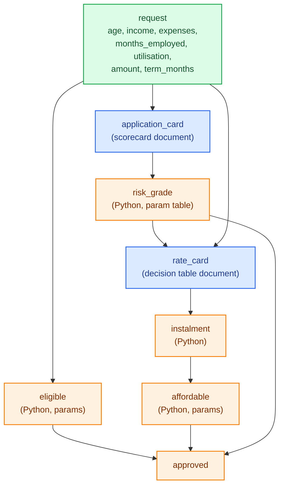
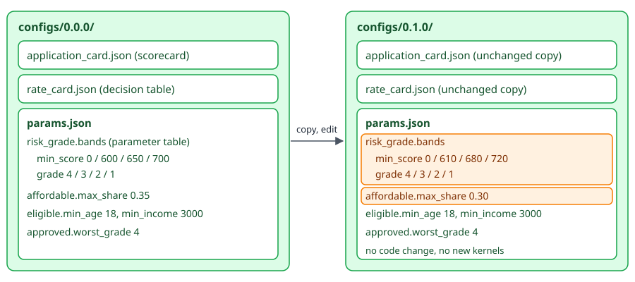
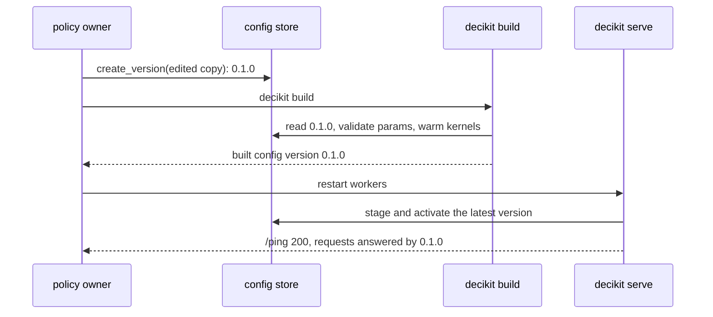

# Tutorial: loan granting and pricing

This tutorial builds a small unsecured loan service from an empty folder. An applicant asks for an amount over a term; the service checks eligibility, scores the application with a points scorecard, maps the score to a risk grade, prices the loan from a rate card, works out the monthly instalment, and tests affordability. Along the way you will:

- write steps as plain Python functions,
- put the scorecard and the rate card in config documents,
- keep the grade cut-offs in a parameter table,
- run a frame of applicants and score one record,
- build and serve the project and call it over HTTP,
- retune the grade cut-offs and the affordability limit through a new config version, with no code change.

It follows the shape of the larger loan granting example project in the repository (`examples/loan-granting-pricing`), cut down to one screen of code.



## 1. Create the project

```bash
$ decikit template flex_loan
created flex_loan/README.md
created flex_loan/__init__.py
created flex_loan/configs/0.0.0/params.json
created flex_loan/conftest.py
created flex_loan/.env
created flex_loan/inference.py
created flex_loan/pipeline.py
created flex_loan/sample_request.json
created flex_loan/tests/test_pipeline.py
```

The template is a working credit project. We replace its pipeline, config and tests below; `inference.py`, `conftest.py` and `.env` stay as they are. [Projects and serving](../guides/projects-and-serving.md) explains each file.

## 2. Write the steps

Replace `flex_loan/pipeline.py`:

```python
"""Flex Loan granting and pricing: eligibility, an application scorecard, a risk grade,
a rate card, the instalment and an affordability test."""
from decikit import ParamTable, flow, param, param_table


def eligible(age: float, monthly_income: float,
             min_age: float = param(18.0), min_income: float = param(3000.0)) -> bool:
    return age >= min_age and monthly_income >= min_income


def risk_grade(app_score: float,
               bands: ParamTable = param_table({"min_score": float, "grade": int},
                                               default=[{"min_score": 0.0, "grade": 4},
                                                        {"min_score": 600.0, "grade": 3},
                                                        {"min_score": 650.0, "grade": 2},
                                                        {"min_score": 700.0, "grade": 1}])) -> int:
    grade = 5
    for i in range(len(bands.min_score)):
        if app_score >= bands.min_score[i]:
            grade = bands.grade[i]
    return grade


def instalment(amount: float, term_months: float, annual_rate: float) -> float:
    r = annual_rate / 12.0
    if r == 0.0:
        return round(amount / term_months, 2)
    return round(amount * r / (1.0 - (1.0 + r) ** -term_months), 2)


def affordable(instalment: float, monthly_income: float, monthly_expenses: float,
               max_share: float = param(0.35, ge=0.0, le=1.0)) -> bool:
    return instalment <= (monthly_income - monthly_expenses) * max_share


def approved(eligible: bool, affordable: bool, risk_grade: int, worst_grade: int = param(4)) -> bool:
    return eligible and affordable and risk_grade <= worst_grade


def build(application_card, rate_card):
    return flow(eligible, application_card, risk_grade, rate_card, instalment, affordable, approved,
                name="flex_loan").emit("app_score", "risk_grade", "annual_rate", "instalment", "eligible", "affordable")
```

Each function's arguments are the values it reads and its name is the value it writes. Request fields (`age`, `amount`) are plain arguments; policy numbers (`min_income`, `max_share`) are `param()`s, read from the params document. `risk_grade` loops over a [parameter table](../guides/parameter-tables.md) of score cut-offs, so the cut-offs, and how many grades there are, can change per config version.

`build` takes two arguments, `application_card` and `rate_card`. When the project is built or served, each receives the config version's document of that name, already loaded. `flow` runs the steps in the order written; `.emit(...)` keeps intermediate values in the output, which otherwise only holds the inputs and the values nothing else reads. [Steps and params](../guides/steps-and-params.md) covers all of this.

`round(x, 2)` in a step rounds half to even, as CPython does. Real money belongs in `Currency`; this tutorial keeps floats to stay short ([types and money](../guides/types-and-money.md) shows the `Currency` version).

## 3. Write the config documents

The scorecard goes in `flex_loan/configs/0.0.0/application_card.json`:

```json
{"type": "scorecard", "name": "application_card", "output_name": "app_score",
 "variables": [
   {"type": "constant", "score": 600, "output_name": "base_points"},
   {"type": "scored", "variable_name": "age", "default": {"value": 0},
    "bins": [{"value": -20, "upper_bound": 25}, {"value": 10, "lower_bound": 25, "upper_bound": 55},
             {"value": 20, "lower_bound": 55}]},
   {"type": "scored", "variable_name": "months_employed", "default": {"value": -15},
    "bins": [{"value": -10, "upper_bound": 12}, {"value": 15, "lower_bound": 12, "upper_bound": 60},
             {"value": 40, "lower_bound": 60}]},
   {"type": "scored", "variable_name": "utilisation", "default": {"value": 0},
    "bins": [{"value": 50, "upper_bound": 0.3}, {"value": 10, "lower_bound": 0.3, "upper_bound": 0.8},
             {"value": -40, "lower_bound": 0.8}]}
 ]}
```

The rate card goes in `flex_loan/configs/0.0.0/rate_card.json`. Each grade has a ladder of amount bands; the first row an application matches sets `annual_rate`:

```json
{"type": "decision_table", "name": "rate_card",
 "columns": {"grade": "Int64", "amt_lo": "Float64", "amt_hi": "Float64", "annual_rate": "Float64"},
 "rows": [
   {"grade": 1, "amt_lo": null, "amt_hi": 50000, "annual_rate": 0.135},
   {"grade": 1, "amt_lo": 50000, "amt_hi": null, "annual_rate": 0.115},
   {"grade": 2, "amt_lo": null, "amt_hi": 50000, "annual_rate": 0.175},
   {"grade": 2, "amt_lo": 50000, "amt_hi": null, "annual_rate": 0.155},
   {"grade": 3, "amt_lo": null, "amt_hi": 50000, "annual_rate": 0.215},
   {"grade": 3, "amt_lo": 50000, "amt_hi": null, "annual_rate": 0.195},
   {"grade": 4, "amt_lo": 0, "amt_hi": null, "annual_rate": 0.255}
 ],
 "expression": {"type": "and", "expressions": [
   {"type": "eq", "variable": "risk_grade", "value_column": "grade"},
   {"type": "between", "variable": "amount", "lower_bound_column": "amt_lo", "upper_bound_column": "amt_hi"}]},
 "outputs": ["annual_rate"], "default": [0.275]}
```

Grade 4 has one row, so it needs at least one bound: a one-row ladder with both bounds `null` is refused with `Row 0: both bounds are unresolvable`. [Trees, tables and scorecards](../guides/trees-tables-scorecards.md) explains bins, ladders and the other options.

The params document, `flex_loan/configs/0.0.0/params.json`, holds every param under the step that declares it. `build(...).parameters().defaults()` prints this shape with the defaults filled in, which is the easiest way to start one:

```json
{
  "flex_loan": {
    "eligible": {"min_age": 18.0, "min_income": 3000.0},
    "risk_grade": {"bands": [
      {"min_score": 0.0, "grade": 4},
      {"min_score": 600.0, "grade": 3},
      {"min_score": 650.0, "grade": 2},
      {"min_score": 700.0, "grade": 1}
    ]},
    "affordable": {"max_share": 0.35},
    "approved": {"worst_grade": 4}
  }
}
```

Finally, one representative request in `flex_loan/sample_request.json`. `decikit build` warms every kernel with it:

```json
{"age": 34, "monthly_income": 28000, "monthly_expenses": 14000, "months_employed": 40, "utilisation": 0.25, "amount": 60000, "term_months": 36}
```

## 4. Run a frame of applicants

From the folder that contains `flex_loan/`, load the latest config version, build the pipeline and run it over four applicants:

```python
import polars as pl
from decikit import ConfigurableStep
from decikit.config import JsonFileStore
from flex_loan.pipeline import build

store = JsonFileStore(basepath="flex_loan/configs")
config = store.read(store.latest_version()).config
pipeline = build(ConfigurableStep.load(config["application_card"]), ConfigurableStep.load(config["rate_card"]))
params = config["params"]

applicants = pl.DataFrame({
    "age": [34.0, 23.0, 61.0, 45.0],
    "monthly_income": [28000.0, 9000.0, 41000.0, 2500.0],
    "monthly_expenses": [14000.0, 6500.0, 12000.0, 1000.0],
    "months_employed": [40.0, 6.0, 120.0, None],
    "utilisation": [0.25, 0.92, 0.10, 0.50],
    "amount": [60000.0, 30000.0, 150000.0, 5000.0],
    "term_months": [36.0, 24.0, 60.0, 12.0],
})
out = pipeline.run(applicants, params=params)
print(out.select("app_score", "risk_grade", "annual_rate", "instalment", "eligible", "affordable", "approved"))
```

```text
shape: (4, 7)
┌───────────┬────────────┬─────────────┬────────────┬──────────┬────────────┬──────────┐
│ app_score ┆ risk_grade ┆ annual_rate ┆ instalment ┆ eligible ┆ affordable ┆ approved │
│ ---       ┆ ---        ┆ ---         ┆ ---        ┆ ---      ┆ ---        ┆ ---      │
│ f64       ┆ i64        ┆ f64         ┆ f64        ┆ bool     ┆ bool       ┆ bool     │
╞═══════════╪════════════╪═════════════╪════════════╪══════════╪════════════╪══════════╡
│ 675.0     ┆ 2          ┆ 0.155       ┆ 2094.64    ┆ true     ┆ true       ┆ true     │
│ 530.0     ┆ 4          ┆ 0.255       ┆ 1608.68    ┆ true     ┆ false      ┆ false    │
│ 710.0     ┆ 1          ┆ 0.115       ┆ 3298.89    ┆ true     ┆ true       ┆ true     │
│ 605.0     ┆ 3          ┆ 0.215       ┆ 466.77     ┆ false    ┆ true       ┆ false    │
└───────────┴────────────┴─────────────┴────────────┴──────────┴────────────┴──────────┘
```

Reading the rows:

- The first applicant scores 600 + 10 (age 34) + 15 (40 months employed) + 50 (utilisation 0.25) = 675, grade 2. R60 000 is in grade 2's upper band, so the rate is 15.5%.
- The second is 23, six months employed and at 92% utilisation: 530, grade 4, 25.5%. The R1 608.68 instalment is more than 35% of the R2 500 left after expenses, so the loan is unaffordable.
- The fourth earns R2 500 a month, under the R3 000 minimum, so is not eligible. Their `months_employed` is null and scored the variable's default, -15.

`pipeline.run` runs the plain Python interpreter. The same pipeline compiles with numba for serving.

## 5. Score one record

A served request is one record. Compile once, then call `score` with a dict:

```python
from decikit import ConfigurableStep
from decikit.config import JsonFileStore
from flex_loan.pipeline import build

store = JsonFileStore(basepath="flex_loan/configs")
config = store.read(store.latest_version()).config
pipeline = build(ConfigurableStep.load(config["application_card"]), ConfigurableStep.load(config["rate_card"]))

exe = pipeline.compile("fused")
record = {"age": 34, "monthly_income": 28000.0, "monthly_expenses": 14000.0, "months_employed": 40.0,
          "utilisation": 0.25, "amount": 60000.0, "term_months": 36}
result = exe.score(record, config["params"])
print({k: result[k] for k in ("app_score", "age_score", "months_employed_score", "utilisation_score",
                              "risk_grade", "annual_rate", "instalment", "approved")})
print(exe.fallbacks())
```

```text
{'app_score': 675.0, 'age_score': 10.0, 'months_employed_score': 15.0, 'utilisation_score': 50.0, 'risk_grade': 2, 'annual_rate': 0.155, 'instalment': 2094.64, 'approved': True}
{}
```

The scorecard writes each variable's points (`age_score` and so on) beside the total, which are the reason codes a decline letter needs. `fallbacks()` is empty: every step, the scorecard, the parameter-table loop and the rate card compiled into kernels. `score` takes the record as a dict, never as keyword arguments, and is the path to use for one decision; running a one-row frame costs several times more.

## 6. Test through the handler

Replace `flex_loan/tests/test_pipeline.py` with tests that send raw JSON through the same handler the server uses, pinned to config version `0.0.0` so a later version doesn't change what they assert:

```python
"""Scores requests through the served handler, raw JSON bytes in, as `decikit serve` does."""
import json
from pathlib import Path

from decikit.config import JsonFileStore

from flex_loan.inference import Handler

ROOT = Path(__file__).parents[1]
HANDLER = Handler(JsonFileStore(basepath=str(ROOT / "configs")), "flex_loan.pipeline:build")
HANDLER.stage("0.0.0")
HANDLER.activate()


def score(body: bytes) -> dict:
    response = HANDLER.process_fn(body, "application/json", "application/json")
    return json.loads(response.content)


def test_the_sample_request_is_approved_at_grade_2():
    out = score((ROOT / "sample_request.json").read_bytes())
    assert (out["app_score"], out["risk_grade"], out["annual_rate"]) == (675.0, 2, 0.155)
    assert out["instalment"] == 2094.64 and out["approved"] is True


def test_a_thin_file_applicant_is_declined_as_unaffordable():
    out = score(b'{"age": 23, "monthly_income": 9000, "monthly_expenses": 6500, "months_employed": 6,'
                b' "utilisation": 0.92, "amount": 30000, "term_months": 24}')
    assert (out["risk_grade"], out["instalment"], out["affordable"], out["approved"]) == (4, 1608.68, False, False)


def test_income_below_the_minimum_is_ineligible():
    out = score(b'{"age": 45, "monthly_income": 2500, "monthly_expenses": 1000, "months_employed": null,'
                b' "utilisation": 0.5, "amount": 5000, "term_months": 12}')
    assert (out["eligible"], out["approved"]) == (False, False)
```

```bash
$ cd flex_loan && pytest -q
...                                                                      [100%]
3 passed in 3.65s
```

The tests assert exact answers from worked examples. A test that only checks an answer is a bool, or lands in a range, would pass a broken rate card.

## 7. Build and serve

```bash
$ decikit build
decikit: pipeline flex_loan.pipeline:build from /…/flex_loan/pipeline.py
decikit: handler flex_loan.inference:Handler from /…/flex_loan/inference.py
built config version 0.0.0 (pipeline flex_loan.pipeline:build, mode fused)
```

`decikit build` imported the pipeline, loaded version `0.0.0`'s two documents, validated its params document, and scored `sample_request.json` through every kernel, which fills numba's disk cache so the server starts without compiling. Then serve it (one worker on a chosen port here; the defaults are port 8080 and 2 × CPUs + 1 workers):

```bash
$ decikit serve --workers 1 --port 39109 --host 127.0.0.1
INFO:     Started server process [4020015]
INFO:     Waiting for application startup.
decikit: pipeline flex_loan.pipeline:build from /…/flex_loan/pipeline.py
decikit: handler flex_loan.inference:Handler from /…/flex_loan/inference.py
INFO:     Application startup complete.
INFO:     Uvicorn running on http://127.0.0.1:39109 (Press CTRL+C to quit)
```

```bash
$ curl -s -d @sample_request.json -H 'content-type: application/json' localhost:39109/invocations
{"age":34,"monthly_income":28000,"monthly_expenses":14000,"months_employed":40,"utilisation":0.25,"amount":60000,"term_months":36,"approved":true,"base_points":600.0,"age_score":10.0,"months_employed_score":15.0,"utilisation_score":50.0,"app_score":675.0,"risk_grade":2,"annual_rate":0.155,"instalment":2094.64,"eligible":true,"affordable":true}

$ curl -s -H 'content-type: application/json' -d '{"age": 23, "monthly_income": 9000, "monthly_expenses": 6500, "months_employed": 6, "utilisation": 0.92, "amount": 30000, "term_months": 24}' localhost:39109/invocations
{"age":23,"monthly_income":9000,"monthly_expenses":6500,"months_employed":6,"utilisation":0.92,"amount":30000,"term_months":24,"approved":false,"base_points":600.0,"age_score":-20.0,"months_employed_score":-10.0,"utilisation_score":-40.0,"app_score":530.0,"risk_grade":4,"annual_rate":0.255,"instalment":1608.68,"eligible":true,"affordable":false}
```

The response holds the request plus every output. A JSON object takes the single-record path, as `score` did in step 5; a JSON array, CSV or Parquet body runs as a frame. Errors come back as JSON with a status code; the [serving guide](../guides/projects-and-serving.md) lists the real ones.

## 8. Retune through a new config version

Credit policy tightens: the grade cut-offs move up and instalments may take at most 30% of disposable income instead of 35%. Both are params, so the change is a new config version and no code changes. A version is immutable and holds every document, so copy the latest and edit the copy:

```python
import copy
from decikit.config import JsonFileStore

store = JsonFileStore(basepath="configs")
current = store.read(store.latest_version())
config = copy.deepcopy(current.config)
config["params"]["flex_loan"]["risk_grade"]["bands"] = [
    {"min_score": 0.0, "grade": 4},
    {"min_score": 610.0, "grade": 3},
    {"min_score": 680.0, "grade": 2},
    {"min_score": 720.0, "grade": 1},
]
config["params"]["flex_loan"]["affordable"]["max_share"] = 0.30
new = store.create_version(config)
print(current.version, "->", new.version)
print(sorted(store.versions()))
```

```text
0.0.0 -> 0.1.0
[Version(major=0, minor=0, patch=0), Version(major=0, minor=1, patch=0)]
```

<div class="diagram" markdown>


*A new version is a full copy; only the params that policy changed differ.*
</div>

`configs/0.1.0/` now sits beside `configs/0.0.0/`, with all three documents. Build it, then restart the server, which stages the latest version when it starts:

```bash
$ decikit build
built config version 0.1.0 (pipeline flex_loan.pipeline:build, mode fused)
$ decikit serve --workers 1 --port 39109 --host 127.0.0.1
$ curl -s -d @sample_request.json -H 'content-type: application/json' localhost:39109/invocations
{"age":34,"monthly_income":28000,"monthly_expenses":14000,"months_employed":40,"utilisation":0.25,"amount":60000,"term_months":36,"approved":true,"base_points":600.0,"age_score":10.0,"months_employed_score":15.0,"utilisation_score":50.0,"app_score":675.0,"risk_grade":3,"annual_rate":0.195,"instalment":2214.56,"eligible":true,"affordable":true}
```

The same applicant, with the same score of 675, is now grade 3 (the grade 2 cut-off moved to 680), priced at 19.5%, with an instalment of R2 214.56. It is still affordable: 30% of R14 000 is R4 200. The cut-offs reach the compiled kernel as data, so the new version needs no new kernels. The tests still pass because they pin version `0.0.0`; add tests for `0.1.0` that assert its answers.



A version that doesn't validate never goes live: `max_share` is declared `param(0.35, ge=0.0, le=1.0)`, so a version with `1.5` fails `decikit build` with a `ParamsError`, and `RequestHandler.stage` raises the same error while the active version keeps serving. In a long-running process you can also call `handler.stage("0.1.0")` and `handler.activate()`, and `handler.rollback()` to go back.

## 9. Compare the two versions

Before a version ships, run both over the same applicants:

```python
import polars as pl
from decikit import ConfigurableStep
from decikit.config import JsonFileStore
from flex_loan.pipeline import build

store = JsonFileStore(basepath="flex_loan/configs")
applicants = pl.DataFrame({
    "age": [34.0, 23.0, 61.0, 45.0],
    "monthly_income": [28000.0, 9000.0, 41000.0, 2500.0],
    "monthly_expenses": [14000.0, 6500.0, 12000.0, 1000.0],
    "months_employed": [40.0, 6.0, 120.0, None],
    "utilisation": [0.25, 0.92, 0.10, 0.50],
    "amount": [60000.0, 30000.0, 150000.0, 5000.0],
    "term_months": [36.0, 24.0, 60.0, 12.0],
})
results = {}
for version in store.versions():
    config = store.read(version).config
    pipeline = build(ConfigurableStep.load(config["application_card"]), ConfigurableStep.load(config["rate_card"]))
    results[str(version)] = pipeline.compile("fused").run(applicants, config["params"])
print(pl.DataFrame({
    "app_score": results["0.0.0"]["app_score"],
    "grade_0.0.0": results["0.0.0"]["risk_grade"], "grade_0.1.0": results["0.1.0"]["risk_grade"],
    "rate_0.0.0": results["0.0.0"]["annual_rate"], "rate_0.1.0": results["0.1.0"]["annual_rate"],
    "approved_0.0.0": results["0.0.0"]["approved"], "approved_0.1.0": results["0.1.0"]["approved"],
}))
```

```text
shape: (4, 7)
┌───────────┬─────────────┬─────────────┬────────────┬────────────┬────────────────┬───────────────┐
│ app_score ┆ grade_0.0.0 ┆ grade_0.1.0 ┆ rate_0.0.0 ┆ rate_0.1.0 ┆ approved_0.0.0 ┆ approved_0.1. │
│ ---       ┆ ---         ┆ ---         ┆ ---        ┆ ---        ┆ ---            ┆ 0             │
│ f64       ┆ i64         ┆ i64         ┆ f64        ┆ f64        ┆ bool           ┆ ---           │
│           ┆             ┆             ┆            ┆            ┆                ┆ bool          │
╞═══════════╪═════════════╪═════════════╪════════════╪════════════╪════════════════╪═══════════════╡
│ 675.0     ┆ 2           ┆ 3           ┆ 0.155      ┆ 0.195      ┆ true           ┆ true          │
│ 530.0     ┆ 4           ┆ 4           ┆ 0.255      ┆ 0.255      ┆ false          ┆ false         │
│ 710.0     ┆ 1           ┆ 2           ┆ 0.115      ┆ 0.155      ┆ true           ┆ true          │
│ 605.0     ┆ 3           ┆ 4           ┆ 0.215      ┆ 0.255      ┆ false          ┆ false         │
└───────────┴─────────────┴─────────────┴────────────┴────────────┴────────────────┴───────────────┘
```

Three of the four applicants move down a grade and pay more; no approval changes on this sample. For a real comparison over a dataset, with per-column change counts, use [`decikit.lab.diff`](../guides/diff-and-equivalence.md) or an [experiment](../guides/experiments.md); the [compare two policy versions](compare-two-policy-versions.md) tutorial walks through one.

## Where to go next

- [Trees, tables and scorecards](../guides/trees-tables-scorecards.md): put the rate card's rows in the params document (`"rows": {"table": ...}`) so pricing can change them like the grade cut-offs.
- [Debugging and testing](../guides/debugging-and-testing.md): step through one applicant's decision, and break on a rate-card row.
- [Tracing](../guides/tracing.md): record which steps and branches each decision took.
- [Checks](../guides/checks.md): `decikit check flex_loan.pipeline:build` flags float money and other risks before release.
